<sup> Author: Artur Huk | [GitHub](https://github.com/huka81/decision-intelligence-runtime) | Created: 2026-03-06 | Last updated: 2026-11-09 </sup>

---

# DIR-minified: Decision Intelligence Runtime  -  Implementation Context Reference

### LLM-Optimized Context Projection | ROA + DIR + Topologies

---

## 0. HOW TO USE THIS DOCUMENT

This file is a **condensed implementation context** for the Decision Intelligence Runtime (DIR) framework. Load it before asking an LLM to implement, extend, or review a DIR-compliant system.

> **Canonical precedence:** On any conflict, the four canonical documents govern meaning: [ROA_Manifesto.md](../01-roa-manifesto/ROA_Manifesto.md), [DIR_Architectural_Pattern.md](../02-decision-runtime/DIR_Architectural_Pattern.md), [DIR_Topologies.md](../03-topologies/DIR_Topologies.md), [DIR_Governance.md](../04-governance/DIR_Governance.md). This file is a projection for prompt context — not a second constitution.

**What this document contains:**
- Complete specification of ROA (Responsibility-Oriented Agents)  -  the Identity Layer
- Complete specification of DIR (Decision Intelligence Runtime)  -  the Execution Kernel
- Complete specification of all three Topologies  -  the Signal Flow Layer
- Python coding standards for all generated code
- Reference sample map and unified glossary

**What this document does NOT contain:**
- Full executable implementations (see `samples/` directory)
- Domain-specific business logic
- Infrastructure configuration

**Key principle:** *Intelligence without governance is liability. Agents propose. The Runtime validates and executes. No prompt is a permission.*

---

## 1. MOTIVATION  -  Why DIR Exists

### 1.1 The Day Two and Day Three Problems

AI agents fail in production not because models are wrong, but because the architecture around them is missing. Four failure modes emerge universally:

| Failure | Root Cause | Required Mechanism |
|---------|------------|-------------------|
| **Hallucination Loops** | No retry governor; unbounded feedback cycles | Intent Retry Governor (REASONING_EXHAUSTION state, max ~3 retries) |
| **State Drift (Stale Context)** | TOCTOU race: reasoning completed at T0, execution at T1 | Context hash-binding (ContextSnapshotID) + JIT State Verification |
| **Execution Chaos** | No exactly-once guarantees; duplicate side effects | Idempotency key derived from decision context |
| **Agent Drift (Day Three)** | Kernel Compliance does not guarantee Business Health over time | Post-Execution Governance (Monitors) + Circuit Breaking (Suspension) |

These failures are **not model failures**. They are **architecture failures**. The model reasoned correctly; the system lacked the infrastructure to execute safely in the long term.

### 1.2 Documented Production Failure Cases

The following failure cases were observed in an autonomous multi-agent trading system operating against live financial markets. Each failure traced back not to model limitations but to missing architectural constraints.

**Failure Case 1  -  Hallucination Loops (feedback poisoning)**

The agent attempted to sell a position it no longer held. When the broker API returned an error, the model interpreted this as a signal to "try harder." Without a retry governor, it looped  -  each iteration generating new reasoning and consuming tokens. After three retries, it concluded that it should *buy* the position first in order to then sell it: a complete inversion of the original strategy, hallucinated through feedback poisoning.

- **Root cause:** No retry governor; unbounded feedback cycles
- **Mechanism required:** Intent Retry Governor with explicit `REASONING_EXHAUSTION` terminal tag and a hard maximum (~3 retries before the flow transitions to `ABORTED`)

**Failure Case 2  -  State Drift (TOCTOU)**

The agent began reasoning based on a context snapshot at T0 with price $99.50. LLM inference took ~15 seconds. By T1, the price was $101.20. The "buy at $100" decision executed at $101.20, incurring slippage that invalidated the strategy. This is a classic TOCTOU (Time-of-Check to Time-of-Use) vulnerability  -  well-known in systems programming, almost universally ignored in agent architectures.

- **Root cause:** TOCTOU race condition between reasoning and execution
- **Mechanism required:** `ContextSnapshotID` binding + JIT State Verification. The runtime verifies live state is within `drift_envelope` (e.g., 0.5% price tolerance) immediately before executing any side effect

**Failure Case 3  -  Execution Chaos (duplicate orders)**

Without idempotency controls, network timeouts caused the agent to retry execution. The system bought the same position twice. Then sold twice. Each execution created real financial exposure  -  not because the model was wrong, but because the infrastructure lacked exactly-once guarantees.

- **Root cause:** No idempotency; no duplicate intent protection
- **Mechanism required:** `SHA256(DFID + Step_ID + Canonical_Params)`. A retry with the same `Canonical_Params` returns the cached result; different parameters produce a different key and therefore a different intent — bounded by the Intent Retry Governor

**Failure Case 4  -  Agent Drift (Optimization / Semantic / Environmental)**

The agent operated within its hard limits (e.g., maximum allowed discount of 15%), but over time, it consistently offered the maximum discount to every user to maximize retention. Each individual transaction passed the safety checks (Kernel Compliance), but the aggregate result destroyed profitability (Business Health).

- **Root cause:** Kernel constraints evaluate transactions individually and statelessly, lacking awareness of aggregate trends.
- **Mechanism required:** Post-Execution Governance. Asynchronous monitors analyzing rolling windows of execution data linked via DFID, with the ability to trigger a `SUSPENDED` state in the Agent Registry (Circuit Breaking).

> **Key insight:** In each case, the agent's reasoning was technically sound or within constraints. The failures occurred either *after* reasoning (Day Two: TOCTOU, Chaos) or *in the aggregate* over time (Day Three: Agent Drift). These were failures of architecture, not intelligence.

### 1.3 The Core Thesis

> **Intelligence without governance is liability.**
> To safely deploy AI agents, we need deterministic runtime discipline around probabilistic reasoning.

The shift required:
- **From:** Prompt engineering (hoping the model behaves)
- **To:** System engineering (guaranteeing the system behaves)

**The industry shift  -  from model-centric to execution-centric AI:**

| Paradigm | Success metric | Safety approach | Failure handling |
|----------|---------------|-----------------|-----------------|
| **Model-centric AI** | Reasoning quality, benchmark scores | "Smarter / better aligned model" | Retry, add to system prompt |
| **Execution-centric AI** | Reliability, operational safety, auditability | Deterministic execution boundary + Zero Trust | Structural enforcement, validated guardrails |

The industry is shifting from measuring success by reasoning quality alone to measuring it by reliability and operational safety as first-class concerns. DIR is the architectural pattern that enables this shift. It does not make models smarter  -  it makes them safe enough to trust in production.

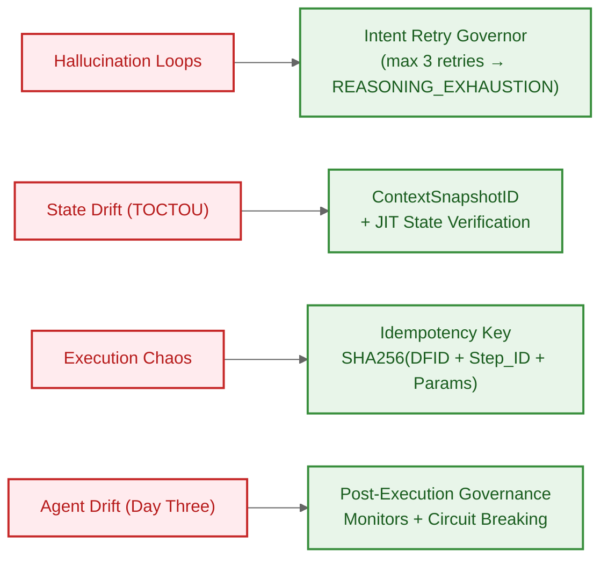

---

### 1.4 Theoretical Model — Illegal State Theory

Large Language Models are semantic engines, not formal state machines. They can propose actions that violate logic, permissions, or temporal realities. DIR is not merely a collection of components — it is an architecture designed to govern which transitions may commit side effects under the **active, human-approved contract**.

A **Legal Decision State (LDS)** is the conjunction of five simultaneously valid conditions:

```
LDS = Authority (A) ∧ Context (C) ∧ Time (T) ∧ Intent (I) ∧ Evidence (E)
```

*   **Authority (A)**: The agent has the explicit permission and boundaries to act (Responsibility Contract).
*   **Context (C)**: All information required to evaluate the legality of a decision (Operational, Business, Governance, and Execution context). **Note: The agent's Mission is formally a subset of Context (`Mission ⊂ Context`). An agent optimizing for the wrong goal triggers a `¬C` violation.**
*   **Time (T)**: The decision is executed before the underlying reality drifts.
*   **Intent (I)**: The proposed action is well-formed and within the contract's syntactic and parametric bounds. (Alignment with the mission belongs to C, because `Mission ⊂ Context`.)
*   **Evidence (E)**: A reproducible justification generated independently from the policy proposal.

An **Illegal Decision State** occurs when any condition is violated:

```
¬LDS = ¬A ∨ ¬C ∨ ¬T ∨ ¬I ∨ ¬E
```

### Component Mapping: What Each DIR Element Protects

| LDS Component | Violation | DIR Protection Mechanism |
|---|---|---|
| **Authority (A)** | Agent proposes action beyond its defined limits | ROA Responsibility Contract — Authority Boundary Generator |
| **Context (C)** | Agent acts on stale, incomplete, or manipulated data | Context Store + CaC (Context as Code) — Context Integrity Layer |
| **Time (T)** | Decision executes after the underlying reality has drifted | Validity Window (TTL) + Drift Envelopes + JIT Verification — Temporal Integrity |
| **Intent (I)** | Proposed action violates contractual or syntactic bounds | SDS Constrained Decoding + DIM Schema and Contract IR gates — Intent Integrity |
| **Evidence (E)** | Rationale is hallucinated or emotionally manipulated | Evidence Governance in User Space (Differential Heuristics, Bidirectional Reconstruction) + DIM Evidence Binding gate (structural only) |

### 1.4.1 Topology Mapping: Each Topology Protects a Different LDS Component

| Topology | Primary Protection | Mechanism |
|---|---|---|
| **EOAM** | ¬C and ¬T | Drift Envelopes + JIT State Verification prevent execution against expired reality |
| **SDS** | ¬I | Constrained Decoding makes generating an illegal intent physically impossible |
| **DL+PCI** | Binding certificate (A, C, T, I, E) | PCI carries cryptographic proof of state, contract, rule, and identity binding — not semantic truth |

### 1.4.2 The DIM as Illegal State Preventer and Kernel Invariant Evaluator

The **Decision Integrity Module (DIM)** must be understood not as a simple validator but as a formal **Illegal State Preventer** and **Kernel Invariant Evaluator**:

> *"The DIM does not judge agent creativity. It deterministically evaluates every active, machine-verifiable rule in the signed contract before creating an ExecutionIntent."*

Each DIM validation step maps directly to an LDS component. Crucially, while Authority ($A$), Context ($C$), Time ($T$), and Intent ($I$) are deterministically computable in polynomial time within the Kernel, **Semantic Truth / Evidence ($E$) is undecidable in a deterministic environment (per Rice's Theorem)**. Therefore, the Kernel checks *structural evidence bindings* (required attestations, hashes, signatures) produced in User Space; it cannot semantically read text to prove $E$. 

| Check (§4.4) | LDS Component Protected |
|---|---|
| Pre-check: Registry status | ¬A — suspended or retired agents cannot act |
| Pre-check: Validity Window (TTL) | ¬T — expired decisions cannot execute |
| Gate 1: Schema & Integrity | ¬I — malformed intent is blocked |
| Gate 2: Authority (RBAC) | ¬A — unauthorized proposals are rejected |
| Gate 3: Snapshot Identity; Gate 5: Mission Invariant | ¬C — agent cannot act on an unknown or contract-mismatched snapshot |
| Gate 4: Resource Reservation | ¬C — two flows cannot consume the same finite resource |
| Gate 6: Contract IR invariants | ¬A, ¬I — parameters outside contract bounds are rejected |
| Gate 7: Evidence Binding | ¬E — missing or invalid evidence bindings are rejected (not semantic truth) |
| JIT State Verification — Execution Engine, not a DIM gate | ¬C, ¬T — live state drifted beyond the envelope |
| Semantic Alignment — Soft Guard, not a DIM gate | ¬E — narrative/policy mismatch surfaced for audit |

This elevates DIR from an API gateway pattern to a formal engineering construct aligned with TLA+, proof-carrying code, and formal verification methodology. Every component exists because one of A, C, T, I, or E must be guaranteed.

---

## 2. ARCHITECTURE OVERVIEW

### 2.1 The Three-Layer Model

DIR is composed of three orthogonal layers. Each layer addresses a distinct architectural concern and can vary independently.

| Layer | Pattern | Question Answered |
|-------|---------|------------------|
| **Identity Layer** | ROA  -  Responsibility-Oriented Agents | *Who* is responsible for proposing intent? |
| **Execution Kernel** | DIR  -  Decision Intelligence Runtime | *Is this intent allowed and valid to execute right now?* |
| **Flow Layer** | Topologies (EOAM / SDS / DL+PCI) | *How do signals and intents move through the system?* |

### 2.2 User Space vs. Kernel Space  -  The Wall

Borrowed from operating systems: the fundamental separation between **unprivileged processes** (agents) and the **privileged kernel** (runtime).

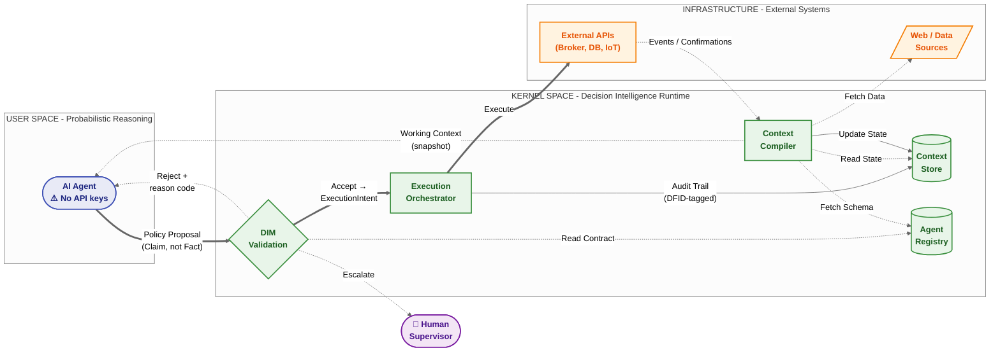
*The Runtime separates User Space (probabilistic reasoning) from Kernel Space (deterministic execution). Agents never hold API keys or write credentials. Every side effect passes through DIM validation. The Context loop ensures agents always reason on Kernel-managed, validated state.*

**The Wall is absolute:**
- Agents MUST NOT hold API keys or database write credentials
- Agents MUST NOT execute side effects directly
- Agents MUST NOT transfer privileged information across trust boundaries (Disclosure is a side effect)
- No prompt grants execution privilege  -  `Prompts are not permissions`
- No "trusted agent" bypasses validation
- LLMs MUST NOT exist in Kernel Space

### 2.3 CQRS Adaptation

DIR is an adaptation of **Command Query Responsibility Segregation (CQRS)**:
- Agents emit **tentative commands** (Policy Proposals)  -  the Write Model
- The Runtime **validates and decides** whether to commit them  -  the Execution
- Only DIM-validated policies trigger side effects

---

## 3. ROA  -  RESPONSIBILITY-ORIENTED AGENTS

> **ROA agents are epistemic entities. They interpret, explain, and propose. They provide no safety, correctness, or enforcement guarantees.**

ROA defines agents not by their *capabilities* (what tools they can call) but by their *responsibilities* (what they are accountable for, what they own, what limits bind them).

### 3.1 Canonical Responsibility Contract

Every ROA agent or agent class is governed by a **Responsibility Contract**: the versioned, human-authored source of governance registered through a trusted CI/CD path. Agents MUST NOT self-register or alter their own contract at runtime.

**Boundary vs. invariant:** A boundary defines where authority ends; an invariant is a deterministic predicate evaluated when a proposal crosses that boundary. Individual predicates are established engineering mechanisms. ROA/DIR places them outside probabilistic reasoning in a governed admissible-transition path.

A canonical contract is architecturally complete when it covers every governance dimension required for its decision class. It does NOT need to enumerate every possible domain rule or contain unused empty blocks.

| Block | Machine meaning |
|---|---|
| `metadata` | Contract identity, version, human owner, source provenance |
| `subject` | Bound agent or agent class, canonical role, hierarchy |
| `mission` | Interpretive goal used in User Space; not executable authority |
| `authority` | Allowed policy types, resource scope, hard transaction limits |
| `execution_conditions` | Context age, drift, reservation, and concurrency requirements |
| `responsibility` | Explainability, evidence attestations, escalation policy |
| `governance` | Aggregate policies and Circuit Breaker responses |

**Canonical authoring form:**

```yaml
api_version: roa.dir/v1
kind: ResponsibilityContract

metadata:
    contract_id: crypto_position_manager
    version: 1.2.0
    owner: jane.doe@example.com
    source_refs: [RISK-POLICY-17]

subject:
    agent_id: crypto_position_manager_01
    role: EXECUTOR
    parent_agent_id: portfolio_strategist_01

mission:
    statement: >
        Manage crypto positions while protecting capital and seeking
        risk-adjusted returns.

authority:
    allowed_policy_types: [BUY, SELL, HOLD, REDUCE_SIZE, CLOSE_POSITION]
    resource_scope:
        instruments: [BTC-USD, ETH-USD]
    limits:
        max_order_size: { value: 50000, unit: USD }
        max_daily_drawdown: { value: 4, unit: percent }
    invariants:
        - id: INV_ORDER_SIZE
          type: range
          field: params.order_value
          max: 50000
          reason_code: CONTRACT_LIMIT_EXCEEDED
          runtime_amendable: true
          min_floor: 1000
          max_ceiling: 100000

execution_conditions:
    max_context_age_seconds: 30
    max_price_slippage: { value: 0.5, unit: percent }
    reservation_required: true

responsibility:
    explainability: required
    evidence:
        level: high
        required_attestations: [context_snapshot, deterministic_risk_check]
    escalation:
        mode: mandatory
        confidence_below: 0.70
        route_to: portfolio_risk_owner

governance:
    aggregate_policies:
        - metric: rolling_drawdown
          window: 24h
          operator: gt
          threshold: 4
          unit: percent
          response: SUSPENDED
```

**Artifact lifecycle:**

```text
Canonical Responsibility Contract
        -> Signed Contract Release
        -> Runtime Enforcement Projection
```

- **Canonical Responsibility Contract:** human-authored source of governance.
- **Signed Contract Release:** normalized, immutable, attributable approved version. Its signature proves integrity, provenance, and accountable approval; it does NOT prove correctness or completeness.
- **Runtime Enforcement Projection:** minimal generated representation consumed by DIM, Evidence Governance, and Post-Execution Monitors. The DIM does NOT interpret the full authoring YAML directly. It evaluates compiled `authority.invariants` IR (`range`, `set`, `state_match`). Set rules support either `allowed` or `denied`; string denylists may use `match: substring`. `applies_to_policy_kinds` scopes rules to proposal phases. Unsupported IR types MUST fail closed at compilation.

During **Build-Time HITL**, an LLM MAY synthesize candidate constraints from source documents or telemetry, but candidates have no authority. A human Contract Owner resolves material ambiguity and approves the canonical version. Deterministic tooling validates and compiles the machine-verifiable subset. Human review is amortized across decisions governed by that release; it is not constant-cost or eliminated.

**Normative rules:**
1. `metadata.owner` MUST identify the accountable human or organizational owner.
2. `api_version` is the compatibility boundary. Incompatible semantics require a new API version.
3. Unsupported critical fields MUST fail closed during projection compilation or registration; they MUST NOT be silently ignored.
4. `responsibility.evidence.level` defines minimum rigor; concrete `required_attestations` remain explicit.
5. Dynamic Registry status (`ACTIVE`, `SUSPENDED`, `DEGRADED`, `ESCALATION_ONLY`, `RETIRED`) is operational state and MUST NOT be embedded in the signed contract payload.
6. Runtime projections and signed releases are derived artifacts, never independent sources of truth.
7. `authority.invariants` is the DIM enforcement IR. Bootstrap limit and exclusion sugar compiles into it; explicit invariants override on id conflict. A set invariant MUST declare `allowed` or `denied`, never both.
8. Runtime parameter mutation uses `ContractParameterAmendment` only for `runtime_amendable: true` scalars inside `min_floor` / `max_ceiling`.

### 3.1.1 The Four Canonical Roles

The `role` field in the Responsibility Contract aligns an agent with its structural purpose in the system. ROA defines four canonical roles:

1. **`INTERFACE` (The Receptionist):** Operates at the edge (DMZ) communicating with external systems or users. Its `Working Context` is deliberately starved of business logic to prevent IP exfiltration. It possesses zero execution authority and can only emit normalized Input Artifacts (bounded JSON payloads) to the internal Event Bus. It is explicitly forbidden from generating a `PolicyProposal`, an `EvidencePackage`, or a `PCI`.
2. **`STRATEGIST` (The Planner):** A high-level agent operating in the Internal Core. It synthesizes broad context over long horizons. It delegates specific tasks to Executors, monitors macro trends, and manages parent DecisionFlows (Sagas).
3. **`EXECUTOR` (The Operator):** The standard tactical agent. Reads parsed payloads from `INTERFACE` agents or delegates from a `STRATEGIST`. Analyzes specific scenarios against rich business rules in its Context Store and produces `PolicyProposals` aimed at the Kernel Space validator (DIM).
4. **`MONITOR` (The Auditor):** A specialized read-only or post-execution governance agent. It audits the `explain` histories of other agents asynchronously to detect phenomena like Semantic Drift. It cannot execute business actions and never calls the Agent Registry directly. To request a circuit breaker it emits a `PolicyProposal` (`policy_kind: SET_AGENT_STATUS`) that the DIM validates against the MONITOR's own contract. Deterministic Aggregate Monitors in Kernel Space may set agent status directly (§4.6).

### 3.2 The Decision Lifecycle: Explain → Policy → Self-Check → Emit

ROA agents produce decisions through a structured four-stage internal process:

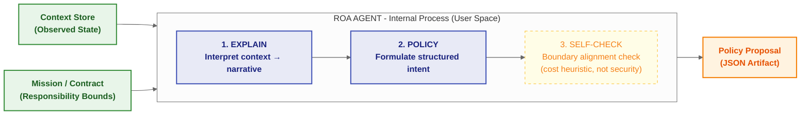

| Stage | What happens | Owner | Purpose |
|-------|-------------|-------|---------|
| **Explain** | Agent interprets context, identifies patterns, articulates situation | LLM | Narrative for human auditors |
| **Policy** | Agent formulates structured, executable intent | LLM | Machine-interpretable proposal |
| **Self-Check** | Agent verifies mission alignment before emitting | LLM (heuristic) | Noise reduction, cost optimization  -  NOT a security gate |
| **Emit** | Agent outputs Policy Proposal JSON artifact | LLM | Input to Runtime |

**Critical:** Self-Check has NO security value. It is a cost-optimization heuristic. All real safety enforcement happens in Kernel Space (DIM).

**ROA agents are long-lived, persistent entities  -  not stateless inference calls.** Unlike ephemeral LLM loops that reset between calls, ROA agents maintain continuity across decision cycles. This property is called **Epistemic Longevity**.

### 3.2a Epistemic Longevity  -  The Third ROA Pillar

ROA agents are characterized by three defining properties. The third is frequently missing from implementations:

| Pillar | Definition | Implementation |
|--------|-----------|----------------|
| **Mission** | Formal optimization objective  -  the agent's "north star" | Registered in Agent Registry; referenced via `mission_context_hash` during DIM validation |
| **Responsibility Contract** | Versioned, machine-evaluated authority boundary | Signed Contract Release registered via CI/CD; DIM evaluates its Runtime Enforcement Projection deterministically |
| **Epistemic Longevity** | Persistent decision trajectory across decision cycles | Memory Context layer in Context Store; managed by Kernel |

**Epistemic Longevity** means each agent maintains an ordered record of:
- Prior Policy Proposals and their `explain` rationales
- DIM validation outcomes (ACCEPTED / REJECTED / ESCALATED) for each proposal
- Execution results and their financial/operational consequences

This trajectory enables coherent multi-cycle reasoning: the agent's current proposal is contextualized by the history of its prior decisions and their outcomes. Without this, agents exhibit **decision amnesia**  -  proposing the same invalid action repeatedly because they cannot remember being rejected.

**Critical implementation rules:**
1. Epistemic Longevity is **Kernel-managed**, not prompt-managed. The Memory Context layer supplies only the *relevant subset* of historical artifacts to each inference call  -  avoiding context window overflow while preventing decision amnesia
2. Persistence is managed via the Context Store (Memory layer), NOT via embedding history in the system prompt
3. Agents MUST NOT manage their own memory state; they return write-back artifacts (explanations, rationales, progress markers) and the Kernel persists them (§3.5)

**Without Epistemic Longevity:** Agent proposes BUY → rejected (position limit) → re-triggered → proposes BUY again → rejected again → infinite loop. The agent has no memory of being rejected.

**With Epistemic Longevity:** Agent proposes BUY → rejected → Memory Context records rejection + reason → next cycle, agent sees "last BUY rejected: POSITION_LIMIT_EXCEEDED" → proposes HOLD instead.

### 3.2b User Space Anatomy: The Agentic DMZ and Epistemic Amnesia

A semantic design pattern in ROA is the **Agentic DMZ (Contextual Air-Gap)**, neutralizing conversational attacks (prompt leaking, reverse-engineering of IP) by leveraging the `INTERFACE` role.

The principle is **Information Hiding**:
1. **The `INTERFACE` Agent (Edge / DMZ):** Suffering from extreme **Epistemic Amnesia** (implemented as Context Starvation), its `WorkingContext` contains zero proprietary business rules or logic—only instructions on how to parse an external conversational prompt into a JSON payload. An attacker cannot extract secrets because the agent simply does not know them.
2. **The `STRATEGIST` / `EXECUTOR` (Internal Core):** Does not talk to external users. It reads the sterile JSON off the Event Bus, queries the Context Store containing the actual business logic, generates bounds-checked decisions, and emits a `PolicyProposal` towards the Kernel Space (DIM) for execution.

This intentionally degrades the agent's conversational "nuance" regarding business decisions to mathematically guarantee trade secrets (Pricing Models, Risk Appetites) cannot be exfiltrated.

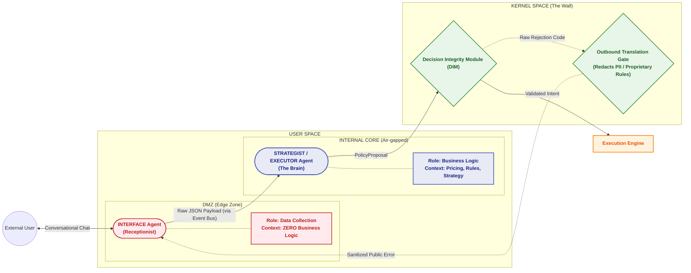

### 3.3 Policy Proposal  -  The Output Contract

The `explain` field is narrative metadata for human auditors  -  it is NEVER parsed for execution logic. The `policy` field is the only machine-processed artifact.

```python
from __future__ import annotations

from datetime import datetime, timezone
from typing import Any

from pydantic import BaseModel, Field


def _utcnow() -> datetime:
    return datetime.now(timezone.utc)


class ExplainResult(BaseModel):
    """Output of Explain stage - context interpretation."""
    dfid: str
    agent_id: str
    timestamp: datetime = Field(default_factory=_utcnow)
    narrative: str = Field(description="Natural language interpretation")
    identified_signals: list[str] = Field(default_factory=list)
    risks: list[str] = Field(default_factory=list)


class PolicyProposal(BaseModel):
    """Structured intent from agent; validated by DIM before execution."""
    dfid: str = Field(description="Runtime-issued DecisionFlow ID (SC-2)")
    agent_id: str
    policy_kind: str = Field(description="The action, e.g. BUY; must be in authority.allowed_policy_types")
    # params / execution_constraints are dynamic payloads typed per policy_kind by the contract schema (TH-6)
    params: dict[str, Any] = Field(default_factory=dict)
    context_ref: str | None = Field(default=None, description="ContextSnapshotID (DIM Gate 3)")
    mission_context_hash: str | None = Field(default=None, description="Mission snapshot hash (DIM Gate 5)")
    execution_constraints: dict[str, Any] = Field(default_factory=dict)
    valid_until: datetime | None = None
    confidence: float = Field(default=1.0, ge=0.0, le=1.0)
    justification: str | None = None
    explain_ref: str | None = None
    attestations: dict[str, str] = Field(default_factory=dict, description="Evidence attestation hashes (DIM Gate 7)")
```

```json
{
  "dfid": "550e8400-e29b-41d4-a716-446655440000",
  "agent_id": "crypto_position_manager_01",
  "policy_kind": "BUY",
  "params": {
    "instrument": "BTC-USD",
    "quantity": 0.05,
    "order_value": 2425.00
  },
  "context_ref": "snap_a1b2c3d4e5f6",
  "mission_context_hash": "mh_7f3a91c2",
  "execution_constraints": {
    "max_price": 48500.00,
    "drift_envelope_bps": 50
  },
  "valid_until": "2026-02-11T14:35:00Z",
  "confidence": 0.78,
  "justification": "BTC has broken above the 20-day MA...",
  "explain_ref": "exp_991a2b3c",
  "attestations": {
    "context_snapshot": "sha256:9c1e...",
    "deterministic_risk_check": "sha256:4b7d..."
  }
}
```

**Claims vs. Facts:** A Policy Proposal is a **Claim** (untrusted assertion). It becomes a **Fact** (executed event) only after the Runtime validates schema, permissions, and state. Authority bias  -  trusting an output because the AI produced it  -  is an anti-pattern.

**Execution Parametrization:** The agent does NOT say "buy at the current price." It says "buy if price ≤ $48,500, only within 5 minutes, with drift tolerance of 50 bps." This decouples slow reasoning time from fast execution time. The `drift_envelope_bps: 50` means the Runtime will reject execution if live price has drifted >0.5% from snapshot price  -  solving TOCTOU without making reasoning faster.

> **"The agent decouples slow reasoning from fast market time."** Policies carry constraints (`max_price`, `valid_until`, `drift_envelope_bps`) rather than raw commands. The Runtime checks these constraints *at the moment of execution*, not at the moment of proposal. This means an agent can take 30 seconds to reason, and the policy will still execute safely  -  or be discarded as stale  -  based on runtime conditions at T₁, not T₀.

### 3.3a ExecutionIntent  -  The Kernel's Output Contract

`PolicyProposal` is the **agent's output** (User Space claim). `ExecutionIntent` is the **Kernel's output** (validated, signed artifact that leaves DIM toward the Execution Engine). These are two distinct classes  -  `ExecutionIntent` does NOT inherit from `PolicyProposal`.

**Ownership rule:** `ExecutionIntent` is created **exclusively by DIM**. No agent, no external system, no test fixture may instantiate it directly. The only valid path to an `ExecutionIntent` is through the DIM validation pipeline.

```python
from __future__ import annotations

from datetime import datetime
from typing import Any

from pydantic import BaseModel, ConfigDict, Field


class ExecutionIntent(BaseModel):
    """
    Validated, Kernel-signed artifact produced by the DIM after all hard gates pass.
    Flows DIM -> Execution Engine -> External API.
    MUST NOT be constructed outside of the DIM validation pipeline.
    """
    model_config = ConfigDict(frozen=True, extra="forbid")

    dfid: str = Field(description="DecisionFlow ID, propagated unchanged from the PolicyProposal")
    step_id: str = Field(description="Runtime-assigned Saga step; 'main' for single-step flows")
    idempotency_key: str = Field(description="SHA256(DFID + Step_ID + Canonical_Params), sec 4.5a")
    policy_kind: str = Field(description="Validated action")
    params: dict[str, Any] = Field(description="Validated execution parameters")
    context_ref: str = Field(description="ContextSnapshotID used as the JIT baseline")
    execution_constraints: dict[str, Any] = Field(description="Drift envelope and slippage, bounded by the contract")
    valid_until: datetime | None = Field(description="Deadline re-checked by the Execution Engine")
    contract_version: str = Field(description="Signed Contract Release version bound to this flow")
    rule_version: str = Field(description="DIM rule-set version (H_r in Topology C)")
    source_proposal_hash: str = Field(description="SHA256 of the canonical PolicyProposal JSON")
    issued_at: datetime = Field(description="DIM issuance time (UTC)")
    kernel_signature: str = Field(description="HMAC-SHA256 over the canonical JSON of all other fields")
```

**Kernel signature:** The HMAC key is held only by the DIM and the Execution Engine (KMS/HSM); agents never see it. The Execution Engine processes every intent in a fixed order: verify `kernel_signature` (reject with `KernelSignatureInvalid`) → idempotency lookup (§4.5a) → JIT drift check and `valid_until` re-check (§4.5) → side effect → audit record.

**Data flow and traceability:**

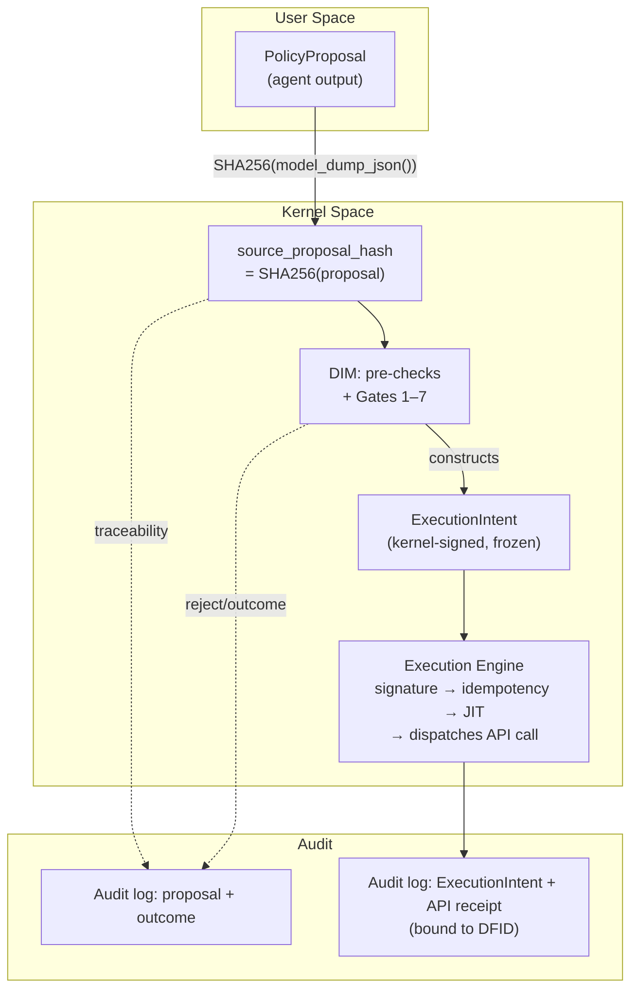

**Key distinctions from PolicyProposal:**

| Property | PolicyProposal | ExecutionIntent |
|----------|---------------|-----------------|
| **Origin** | Agent (User Space) | DIM (Kernel Space) |
| **Trust status** | Untrusted claim | Kernel-validated artifact |
| **Mutability** | Mutable during reasoning | `frozen=True`  -  immutable |
| **`idempotency_key`** | Absent | Present  -  mandatory for execution |
| **`kernel_signature`** | Absent | Present  -  HMAC by DIM, verified by Execution Engine |
| **`justification`** | Present | Absent (Execution engine does not execute text) |
| **Can agent construct?** | Yes | **No  -  DIM only** |

### 3.4 The Evidence Governance Layer (User Space)

While the DIR Kernel guarantees structural integrity, the system is still vulnerable to **"The Compliant Lie"** — a scenario where an LLM generates a structurally valid but semantically erroneous decision (e.g., hallucinating "5 personal cars" instead of "50 heavy trucks").

To address this, the architecture defines the **Evidence Governance Layer** as a first-class citizen in User Space. If the DIR Kernel provides **Execution Governance** (structural and deterministic safety), the Evidence Governance Layer provides **Semantic Governance** (verifiable claims and evidence).

The fundamental shift is moving from *governance of answers* (AI validating AI) to *governance of evidence*. We do not ask "Is the answer correct?", because that is impossible to prove deterministically. Instead, we ask "Does there exist a sufficient evidence package to make this decision?".

In this paradigm, an LLM does not produce *truth*; it produces a **Claim**. The system must then produce an **Evidence Package** to support that claim. Only when the claim and the evidence are combined can a valid output artifact — a `PolicyProposal`, a `Decision Atom`, or a `Proof-Carrying Intent (PCI)` — be submitted to the DIR wall.

DIR formalizes this through an **Evidence Hierarchy** of three tiers:
1. **Heuristic Evidence**: Legacy deterministic checks (SQL View, Regex, Business Rules) verifying narrow parameters.
2. **Reconstructed Evidence**: Independent semantic verification (Bidirectional Reconstruction) ensuring reasoning is stable.
3. **Cryptographic Evidence**: The PCI Hash (SHA256) ensuring identity, state, contract, rule, and intent binding.

The formal pipeline focuses on generating the first two tiers before creating the third:
`Context` $\rightarrow$ `Claim` $\rightarrow$ `Evidence Generators` $\rightarrow$ `Evidence Package` $\rightarrow$ `PCI`

1. **Differential Heuristics (Heuristic Evidence):**
   - **Pattern:** A cheap LLM agent and a legacy deterministic heuristic (e.g., regex, SQL view) process the same context snapshot in parallel.
   - **Mechanism:** The LLM generates a structured *claim*. The heuristic generates baseline *evidence*. The system compares them. If a delta exists, the system halts and escalates. The Kernel does not decide who is right; the User Space simply fails to produce the required evidence package.
2. **Bidirectional Reconstruction:**
   - **Pattern:** Based on *Reconstructable Logic Slices*. Agent A synthesizes context into a JSON *claim*. Agent C (Evidence Generator) reconstructs the original narrative solely from the JSON claim to produce *evidence*.
   - **Mechanism:** The original context and the reconstructed narrative (evidence) are compared. Divergence indicates a Compliant Lie, preventing PCI generation and triggering escalation.

These patterns ensure that by the time an intent reaches the DIR (The Wall), it carries a verifiable, evidence-backed claim rather than a raw probabilistic guess. Note these are *Evidence Generators*, not formal proofs — the only cryptographic proof is a signed PCI's `evidence_hash`, which binds identity, state, contract, rules, and the intent payload, not semantic truth. They apply to any agent output artifact (`PolicyProposal`, `Decision Atom`, or `PCI`), the signed PCI being the strongest form. The Compliant Lie is distinct from **Semantic Drift** (§4.6): the former is a single pre-execution hallucination caught in User Space; the latter is an aggregate post-execution failure caught by Monitors.

### 3.5 Defining Context  -  The Four Domains

**Formal Definition:** Context is all information required to evaluate the legality of a decision. Anything else is noise and must be excluded from the authoritative boundary. `Mission ⊂ Context`.

Agents MUST NOT query external systems directly. All data comes from the Context Store, assembled by the Context Compiler (Kernel Space).

```python
from __future__ import annotations

from datetime import datetime, timezone
from typing import Any

from pydantic import BaseModel, Field


def _utcnow() -> datetime:
    return datetime.now(timezone.utc)


class ContextSnapshot(BaseModel):
    """Frozen state of relevant context at a point in time."""
    snapshot_id: str = Field(description="ContextSnapshotID: SHA256 of the canonical snapshot content")
    dfid: str = Field(description="Associated DecisionFlow ID")
    timestamp: datetime = Field(default_factory=_utcnow)
    # Dynamic payload: its shape is defined by the agent's WorkingContext contract (TH-6)
    data: dict[str, Any] = Field(default_factory=dict, description="Frozen context data")
    source: str = Field(default="context_store", description="Origin of context")
```

| Domain | Storage layer | Persistence | Contents | Purpose |
|-------|---------------|------------|----------|---------|
| **Operational Context** | State | Live, synced from external systems | Real-time signals, resource state (balances), external API states | The "truth" — ground truth for validation |
| **Business Context** | Memory | Persists across sessions | The agent's Mission (`Mission ⊂ Context`, stored as a contract snapshot), long-term memory, prior policy rationales | The "goal and experience" |
| **Governance Context** | Artifacts | Static / versioned | The Responsibility Contract, human escalation chains, allowed instruments, reference rulebooks | The "boundaries" — limits of authority |
| **Execution Context** | Session | Resets at DecisionFlow close | Current trigger, intermediate reasoning, prompt chain, validation feedback | The "now" — ephemeral flow state |

The four semantic domains describe what each slice means for decision legality; the four storage layers (Session, State, Memory, Artifacts) describe how the Context Store keeps them.

**Shared Reality Invariant:** The Context Store is the single authoritative reality for all agents. Agents MUST NOT synchronize via dialogue, local world models, or inferred memory. Shared context prevents conflicting state, reasoning drift, "echo chambers," and emergent inconsistencies. Synchronization is explicit via Kernel-assembled context, never emergent via agent interaction.

**Context Compilation Pipeline:**

```python
def compile_working_context(agent_id: str, dfid: str) -> dict:
    # Step 1: Snapshot authoritative state (optimistic lock)
    current_state = state_store.get_snapshot(timestamp=now())

    # Step 2: Retrieve session events (time-windowed)
    session_events = event_log.query(dfid=dfid, limit=10)

    # Step 3: Retrieve memory and artifacts (deterministic query)
    mission = memory_store.get_mission(agent_id)

    # Step 4: Assemble immutable context object (token budgeting)
    return {
        "snapshot_id": current_state.hash,  # Bound by DIM Gate 3; JIT measures drift against it
        "market_data": current_state.data,
        "recent_history": session_events,
        "mission": mission
    }
```

**Need-to-Know principle:** The Context Compiler enforces strict limits (e.g., "last 10 events", "positions from last 24h") to prevent context window overflow. Agents see only the most relevant, recent slice of reality.

**Agent Read/Write Contract:**
- **Agents read context to:** perform Explain, ground Policy in current facts, maintain reasoning continuity, and verify whether mission/boundaries still apply
- **Agents return write-back artifacts for:** explanations, decision rationales, policy progress/completion markers, and memory trajectory updates. The Kernel appends them, tagged with the DFID, to the Session and Memory layers; agents hold no write access to the Context Store
- **Critical boundary:** write-back does NOT grant authority. The State layer changes only through Kernel-controlled, validated execution

**WorkingContext Contract:** Every implementation MUST explicitly specify its `WorkingContext`. The specification MUST define which Context Store layers are used, which fields are mandatory, and which hashes/refs bind the context to validation (`ContextSnapshotID`, `mission_context_hash`, `evidence_hash`, etc.). `WorkingContext` is architecture-specific, but it MUST NEVER be implicit.

**Context Store vs. Memory vs. Knowledge  -  Disambiguation:**

This distinction is frequently confused in agent system design:

| Term | In DIR | Scope | Managed by |
|------|--------|-------|-----------|
| **Context Store** | The complete 4-layer structured store (Session + State + Memory + Artifacts) | Full system | Kernel Space (Context Compiler) |
| **Memory** | Specifically the Long-term layer of the Context Store  -  cross-session decision history | Agent-scoped, persisted | Kernel Space |
| **Knowledge** | A property of the LLM's pre-trained weights  -  implicit, static, unauditable | Model-internal | NOT in Context Store; cannot be controlled |

**Critical rule:** Agents MUST NOT rely on LLM "knowledge" (pre-training data) as a source of business facts, rules, or real-time data. All business-relevant information MUST enter via the Context Store. LLM knowledge provides linguistic reasoning capability; Context Store provides domain facts.

### 3.6 Dynamic Agents, Hierarchy, and the Agent Registry

**Dynamic instantiation:** Agents are NOT pre-compiled static roles. They are instantiated when a new unit of responsibility is identified and retired when that responsibility ends.

- **Class Agents:** Represent a general capability/role; exist throughout system lifetime
- **Instance Agents:** Represent specific occurrences of responsibility; created when needed, retired when their lifecycle ends (e.g., a PositionAgent created when a trade is opened, retired when closed)

**Agent Hierarchy:** Mirrors organizational responsibility structures:
- Higher-level agents **delegate** specific responsibilities to lower-level agents
- Lower-level agents **escalate** when encountering situations beyond their authority
- Higher-level agents can **override** subordinate proposals  -  within their own governance bounds

**Agent Registry:** The Kernel's single source of truth for agent identity, capabilities, and lifecycle:
- **Capability Contract:** When DIM asks "Can Agent X trade Asset Y?", it queries the Registry  -  not the Agent
- **Registration vs. handshake:** Only the trusted CI/CD path registers a Signed Contract Release. At startup an agent performs a handshake (`agent_id`, `contract_version`) and never uploads a contract; registration attempts by agents are rejected (`RegistrationForbidden`)
- **Lifecycle Management:** Create, initialize, persist, retire agents
- **Schema Versioning:** SemVer alignment required; version mismatch → handshake rejected
- **Resource Locking:** Registry grants temporary Reservation Locks to prevent horizontal resource contention
- **SPOE Mitigation:** Local Responsibility Contract Caching with TTL (e.g., 60s); degraded mode serves cached definitions during Registry outage

**The Four Conceptual Authorities of the Agent Registry:**

| Authority | Description |
|-----------|-------------|
| **Identity** | Who is this agent? Canonical ID, version, owner (team/system) |
| **Capability** | What is this agent authorized to do? Derived from `ResponsibilityContract` |
| **Lifecycle** | What is this agent's operational state? (INITIALIZING, ACTIVE, SUSPENDED, DEGRADED, ESCALATION_ONLY, RETIRED) |
| **Schema** | What version of PolicyProposal schema does this agent produce? (for DIM compatibility) |

**Flow binding rule:** Non-critical Registry updates (e.g., contract version change, authority expansion) are NOT applied retroactively to in-flight DecisionFlows. A DecisionFlow remains bound to the contract snapshot active at `CREATED`; new DecisionFlows pick up the newer version. This prevents race conditions between capability changes and active executions.

**Revocation exception:** Authority revocation, contract invalidation, or kill-switch is a security exception. If detected during JIT or later validation, the flow MUST transition to `ABORTED`. No policy may execute under revoked authority, even if the flow started under an earlier contract snapshot.

**Registry supports all topologies simultaneously:** A single Agent Registry instance can serve agents operating under different topologies (EOAM, SDS, DL+PCI). The topology is a routing/coordination concern, not a registry concern.

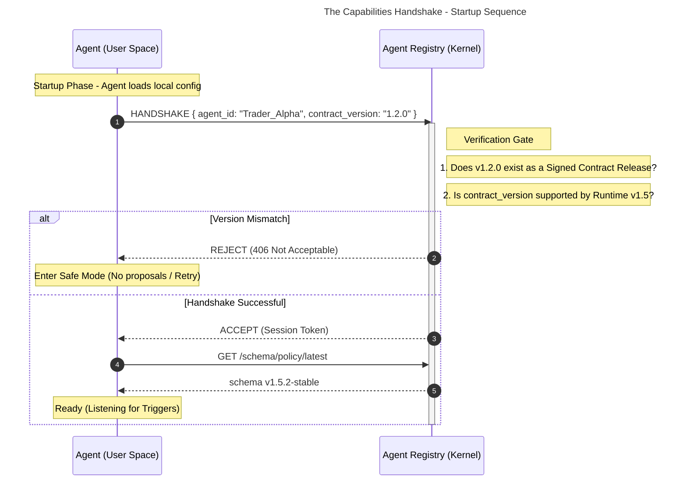

### 3.7 Agent Lifecycle  -  State Transitions and Ownership

The Agent Registry manages each agent's lifecycle state. **Who triggers what** is precisely defined  -  ambiguity here leads to agents self-promoting authority or to zombie agents blocking resource locks.

**Lifecycle state machine:**

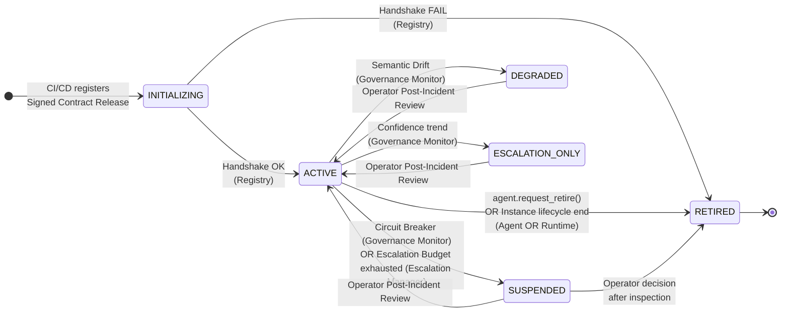

**Transition ownership table:**

| Transition | Triggered by | Condition |
|-----------|-------------|-----------|
| `INITIALIZING → ACTIVE` | Registry | Handshake schema + version check passed |
| `INITIALIZING → RETIRED` | Registry | Handshake failed  -  incompatible version or unauthorized ID |
| `ACTIVE → SUSPENDED` | Governance Monitor (Circuit Breaker) | Hard aggregate limit crossed — DIM rejects all proposals |
| `ACTIVE → SUSPENDED` | Escalation Manager | Escalation Budget exhausted (§4.7) |
| `ACTIVE → DEGRADED` | Governance Monitor (Circuit Breaker) | Semantic Drift detected — specific capability revoked at DIM |
| `ACTIVE → ESCALATION_ONLY` | Governance Monitor (Circuit Breaker) | Confidence trend — every proposal routed to human review |
| `ACTIVE → RETIRED` | **Agent** (only allowed self-transition) OR Runtime | Agent calls `registry.request_retire(agent_id, reason)` after completing its mission; OR Runtime closes Instance Agent lifecycle |
| `SUSPENDED / DEGRADED / ESCALATION_ONLY → ACTIVE` | Operator | Post-Incident Review with documented justification (audit trail required) |
| `SUSPENDED → RETIRED` | Operator | Post-inspection decision |

**Critical rules:**

1. **Agent authority over own state is minimal:** An agent may only call `registry.request_retire()`. It cannot transition itself to ACTIVE, SUSPENDED, DEGRADED, or ESCALATION_ONLY. Those transitions are made only by deterministic Kernel components (Governance Monitor, Escalation Manager) or operators. An LLM-based `MONITOR` agent can only request one through a DIM-validated `SET_AGENT_STATUS` proposal; once executed, it is recorded as `governance_monitor` with its DFID.
2. **`triggered_by` is a closed set:** `registry`, `governance_monitor`, `escalation_manager`, `operator`, `agent` (self-retirement only).
3. **SUSPENDED does not mean RETIRED:** A SUSPENDED agent's resource locks are released, but its Responsibility Contract and Memory Context remain intact. Operator inspection determines final disposition.
4. **`ESCALATED` is a DecisionFlow state, not an Agent state:** A single flow pauses at `ESCALATED` awaiting human input (§4.3). `ESCALATION_ONLY` is an Agent Registry mode where every new proposal requires human review. See [DIR_Governance.md](../04-governance/DIR_Governance.md), Section 4.3.
5. **Registry update vs. state transition:** Updating a contract version is NOT a state transition. A contract update that passes validation leaves the agent in `ACTIVE`. A failed update attempt does NOT change lifecycle state.

**`AgentLifecycleState` enum:**

```python
from __future__ import annotations

from enum import StrEnum


class AgentLifecycleState(StrEnum):
    INITIALIZING     = "INITIALIZING"
    ACTIVE           = "ACTIVE"
    SUSPENDED        = "SUSPENDED"
    DEGRADED         = "DEGRADED"
    ESCALATION_ONLY  = "ESCALATION_ONLY"
    RETIRED          = "RETIRED"
```

### 3.8 ROA as Governance Wrapper for Generative Frameworks

ROA can wrap existing frameworks (LangChain, CrewAI, AutoGen) using the **Boxed Intelligence Pattern**:

1. **Inbound:** ROA Wrapper injects Context Store + Mission into the generative framework
2. **Processing:** Internal agents (e.g., CrewAI Crew) collaborate freely using emergent reasoning
3. **Outbound:** Internal agents are stripped of all execution tools. Their only available action is `emit_policy_proposal()`

This sandboxes the swarm: high-variance creative reasoning + zero-variance safe execution.

**Without ROA:** Agent produces `exchange.create_order(symbol="ETH-USD", amount=15500)` directly → if decimal separator is misinterpreted (15.500 ETH vs 15,500 ETH), catastrophic loss occurs instantly.

**With ROA:** Agent produces `PolicyProposal(policy_kind="BUY", params={"instrument": "ETH-USD", "quantity": 15500, "order_value": 38750000})` → DIM Gate 6 evaluates `INV_ORDER_SIZE` (max USD 50,000) → rejected before reaching the exchange.

### 3.9 ROA vs. Current Industry Approaches

> **"Responsibility is the missing primitive."** Current agent frameworks provide powerful capabilities but omit the accountability layer. ROA supplies that layer.

| Approach | What it provides | What it lacks |
|----------|-----------------|---------------|
| **Tool-Oriented Agents** (function calling) | Actions mapped to tools | Accountability: who authorized this tool call? |
| **Multi-Agent Conversation** (AutoGen, CrewAI) | Emergent reasoning, collaboration | Auditability: which agent is responsible for this outcome? |
| **Workflow-Driven** (LangGraph, Temporal) | Deterministic execution paths | Contextual reasoning within steps |
| **Persona-Based Agents** | Behavioral consistency | Bounded authority: personas don't constrain actions |
| **ROA** | Bounded accountability + contextual reasoning | Combines all above; delegates creativity, constrains consequence |

**Key insight:** ROA does not compete with these frameworks. It wraps them (see §3.8 Boxed Intelligence Pattern), providing the governance layer they were not designed to include.

**DIR vs. the agent safety landscape  -  where each tool operates:**

| Tool / Approach | Where it operates | What it guards |
|-----------------|------------------|----------------|
| **LangChain / LangGraph / CrewAI** | User Space  -  reasoning orchestration | Quality of reasoning chains |
| **Anthropic Constitutional AI** | Inference time  -  training/RLHF | Harmful output suppression |
| **Pydantic schema validation** | Inference time  -  output parsing | Structural validity of output |
| **DIR** | **Execution boundary  -  Kernel Space** | Authorization, state integrity, idempotency, auditability |

**Critical rule:** These approaches are **complementary, not competitive**. An application built on LangChain can integrate DIR as security middleware  -  gaining Zero Trust validation, JIT state verification, and idempotency guarantees without modifying core reasoning logic. DIR is a **safety layer for mission-critical systems**, not a replacement for reasoning frameworks.

> **"Agents built on LangChain or CrewAI operate in User Space. DIR provides the Kernel Space layer they lack: the execution boundary they were not designed to include."**

### 3.10 ROA and Reinforcement Learning  -  Complementarity

> **"DIR is RL-ready."** ROA/DIR does not replace Reinforcement Learning; it complements it.

- **RL role:** Training agents to produce better Policy Proposals  -  optimizing the `explain → policy` generation quality over time
- **DIR role:** Providing the stable, safe execution environment within which RL agents operate during both training and production
- **How they interact:** RL reward signal is derived from outcomes of DIR-validated executions. The Ledger/Context Store provides ground truth for RL training loops
- **RL without DIR:** High-performing RL agents with no execution guardrails → catastrophic failure modes in production (reward hacking, distributional shift)
- **DIR without RL:** Safe execution of rule-based or static agents → limited adaptability over time

**Rule:** When deploying RL agents in production, wrap them with ROA contracts. The contract defines the RL agent's authority envelope. RL optimizes *within* that envelope; DIR *enforces* it.

### 3.11 Confidence ≠ Authority

> **"An agent may propose with confidence=0.99 and still be unauthorized. Confidence scores are observability metadata, not permission grants."**

This is a critical invariant for all DIR implementations:

- **`confidence`** field in `PolicyProposal` (0.0–1.0): The agent's self-assessed certainty about the correctness of the proposal
- **`authority`** in `ResponsibilityContract` (`allowed_policy_types`, `resource_scope`, `limits`, `invariants`): What the agent is *permitted* to do, independent of its certainty

**Common mistake:** Using confidence threshold as the primary safety gate. Example: "If confidence > 0.9, execute without human review."

**Why this fails:** A miscalibrated LLM may output confidence=0.95 for a fundamentally incorrect or out-of-scope proposal. Confidence is a property of the model's probability distribution  -  not a compliance check.

**Correct pattern:**
1. Proposal outside `authority.allowed_policy_types`, `authority.resource_scope`, or a contract invariant (e.g., `authority.limits.max_order_size`) → DIM rejects regardless of confidence
2. All hard gates pass and confidence < `responsibility.escalation.confidence_below` → escalate regardless of action type
3. All hard gates pass and the proposal crosses an approval threshold set below the hard limit, or the agent is in `ESCALATION_ONLY` mode → escalate regardless of confidence

Confidence MAY reduce or increase the *urgency* of human review in escalation workflows. It MUST NOT gate execution authority.

---

## 4. DIR  -  DECISION INTELLIGENCE RUNTIME

DIR is the privileged kernel that turns tentative Policy Proposals into controlled side effects. It is **not** an agent. It contains **no LLMs**. It performs **no semantic reasoning**. Given the same inputs, it always produces the same output by operating as a strict **Admissible Transition Gate**.

**Architectural roots  -  DIR stands on proven engineering foundations:**

| Pattern | Source | How DIR applies it |
|---------|--------|--------------------|
| **Zero Trust Architecture (ZTA)** | NIST SP 800-207 | No agent output is implicitly trusted. Every Policy Proposal traverses a Policy Enforcement Point (DIM) with explicit authorization rules. *Training alignment does not constitute cryptographic provenance.* |
| **CQRS** (Command Query Responsibility Segregation) | Fowler, Young | Agents query Context Store and system state during reasoning (read-only with respect to business state and execution records). Agents return write-back artifacts that the Kernel appends to the Session/Memory layers. Kernel exclusively owns write authority over DecisionFlow, Execution, and Validation records. Clean boundary between intent formation and state modification. |
| **Saga Pattern** | Garcia-Molina & Salem (1987) | Multi-step workflows tracked via DFID parent-child hierarchy. Partial failures trigger pre-registered compensating transactions  -  not agent re-reasoning. |
| **OS Kernel/User Space** | Modern OS design | Privilege separation: agents cannot directly mutate authoritative state or hold execution credentials. The Runtime is the fixed, trusted gatekeeper. |

> **"Policy as a Claim, not a Fact."** DIR treats every agent-generated Policy Proposal as an untrusted claim  -  a structured assertion of the form: "Given this context snapshot, this agent, governed by this contract, asserts that the following action is appropriate." The DIM is the Policy Enforcement Point that evaluates this claim deterministically.

### 4.1 The Four System Invariants

These invariants MUST hold regardless of agent behavior, model updates, or topology:

**Invariant 1  -  Deterministic State Transitions & Kernel Invariant Evaluator:**
User Space (agents, LLMs, prompts) is probabilistic. Kernel Space (validation logic, state machines, API calls) MUST be deterministic and serves strictly as the `Kernel Invariant Evaluator`. Given the same `(Policy, Context, Time)`, the Runtime MUST always return the same Validation Result based on mathematically sound transition rules. Hard Gates MUST be implemented in code (Python/Go/Rego), not prompts. The LLM acts solely as a **Transpiler** (synthesizing intent and generating claims) but never as a **Judge**. Probabilistic validation (LLM-based) MUST remain in User Space or serve as non-blocking auditors only.

**Invariant 2  -  The Reasoning-Execution Wall:**
Agents propose (tentative commands). Runtime validates and executes. No agent holds API keys or database write credentials. No agent opens network sockets. Agents ONLY submit proposals to the Runtime's proposal intake (never to the Event Bus).

**Invariant 3  -  Execution Parametrization (Constraints over Deadlines):**
Agents do NOT propose "buy at current price." Agents propose "buy with limit of $102 (acceptable slippage: 2%), valid until T+30s." The Runtime checks Execution Constraints at the exact moment of execution, decoupling slow reasoning time from fast execution time.

**Invariant 4  -  Auditability by Correlation:**
Every artifact in the system (from initial observation to final API response) is tagged with a **DecisionFlow ID (DFID)**. This enables full causal reconstruction: `Context → Prompt → Reasoning → Proposal → Validation → Execution`. Without this correlation, explaining a system failure is impossible.

### 4.2 DecisionFlow ID (DFID)  -  Distributed Tracing for Reasoning

> **"DFID is a reconstruction primitive  -  one correlation key that binds the minimum evidence needed to answer critical operational questions about a decision."**

DFID is distributed tracing adapted for reasoning chains. It is conceptually a Correlation ID that spans a wider scope than a typical HTTP request  -  it covers the entire lifecycle of a single intent.

**The four operational questions DFID enables answering:**

1. **Why did the system execute this action?** → Policy Proposal + Validation Receipt + Contract/Schema version active at the time
2. **Was the decision stale at execution time?** → Context Snapshot hash + JIT Drift Report (was live state within `drift_envelope`?)
3. **Did the system retry safely, or duplicate the side effect?** → Idempotency Key + Attempt log + External API acknowledgment receipt
4. **Which authority allowed it?** → Agent identity + Agent Registry contract snapshot at DFID creation time

In practice, this turns a postmortem from "the agent traded" into "this exact intent was accepted under these deterministic gates against this exact snapshot, and produced this external receipt." The goal is not to claim perfect correctness  -  it is to make side effects **explainable at the level of inputs and gates**, even when the reasoning remains probabilistic.

**What a DFID binds:**

| # | Artifact | Description |
|---|---------|-------------|
| 1 | **Trigger** | The event or timer that woke the agent |
| 2 | **Context Snapshot** | Hash or link to the exact data the agent saw (enables replayability) |
| 3 | **Reasoning (Explain)** | Raw LLM output explaining *why* |
| 4 | **Policy Proposal** | Structured JSON intent |
| 5 | **Validation Outcome** | Accept/Reject with reason code |
| 6 | **Execution Result** | Final side effect (transaction ID, API response) |

**Structured Decision Telemetry  -  The Audit Reconstruction Pattern:**

Because every layer binds to the same DFID, reconstructing an agent's reasoning and execution lifecycle becomes a deterministic SQL join across the architectural boundary, rather than grepping text logs:

```sql
SELECT f.dfid
     , f.agent_id
     , f.trigger_event
     , c.snapshot_id     AS context_hash
     , p.justification   AS agent_reasoning
     , p.policy_kind     AS proposed_action
     , p.confidence
     , v.outcome         AS validation_result
     , v.reason_code     AS rejection_reason
     , e.idempotency_key
     , e.status          AS execution_status
  FROM decision_flows f
  LEFT JOIN context_snapshots c
    ON f.dfid = c.dfid
  LEFT JOIN policy_proposals p
    ON f.dfid = p.dfid
  LEFT JOIN dim_validations v
    ON f.dfid = v.dfid
  LEFT JOIN execution_log e
    ON f.dfid = e.dfid
 WHERE f.dfid = '550e8400-e29b-41d4-a716-446655440000';
```

This is fundamentally different from prompt logging. The agent's reasoning becomes **one field among many**  -  not the system of record. The system of record is the validated decision and its deterministic execution boundary.

**DFID Record Schema — Persistence Tables:**

The SQL query above joins five tables. `PolicyProposal` (sec 3.3) and `ContextSnapshot` (sec 3.5) are defined in their respective sections — implementations MUST use those canonical definitions. The three tables below are the Runtime-owned persistence records not defined elsewhere:

```python
from __future__ import annotations

import uuid
from datetime import datetime, timezone
from typing import Literal

from pydantic import BaseModel, Field

FlowState  = Literal["CREATED", "ACTIVE", "VALIDATING", "ESCALATED", "ACCEPTED",
                     "EXECUTING", "CLOSED", "ABORTED", "PARTIAL_SUCCESS_DIRTY"]
DIMOutcome = Literal["ACCEPTED", "REJECTED", "ESCALATED"]
ExecStatus = Literal["PENDING", "SUCCESS", "FAILED", "UNKNOWN"]


def _utcnow() -> datetime:
    return datetime.now(timezone.utc)


class DecisionFlow(BaseModel):
    """Master correlation record — created by Runtime at trigger time."""
    dfid:          str        = Field(default_factory=lambda: str(uuid.uuid4()))
    agent_id:      str
    trigger_event: str
    state:         FlowState  = "CREATED"
    tag:           str | None = None   # Terminal reason, e.g. REASONING_EXHAUSTION, STATE_DRIFT_DETECTED
    parent_dfid:   str | None = None   # Hierarchical / Saga pattern (sec 4.8)
    created_at:    datetime   = Field(default_factory=_utcnow)


class DIMValidation(BaseModel):
    """Immutable record of each DIM evaluation — written before outcome is applied."""
    dfid:                str
    outcome:             DIMOutcome
    gate_reached:        int          # 0 = pre-check, 1–7 = last hard gate evaluated
    reason_code:         str | None   # Reason-code table in sec 4.4
    failed_invariant_id: str | None   # Gate 6 only
    attempt_number:      int          # Observability only; the Intent Retry Governor enforces the limit
    evaluated_at:        datetime


class ExecutionLog(BaseModel):
    """Side-effect record — PENDING written after JIT passes, before the API call."""
    dfid:             str
    step_id:          str             # Runtime-assigned; 'main' for single-step flows
    idempotency_key:  str             # SHA256(dfid + step_id + canonical_params) — sec 4.5a
    status:           ExecStatus      # UNKNOWN blocks new intents for (dfid, step_id) until reconciled
    external_receipt: str | None      # Tx ID / API acknowledgment from external system
    executed_at:      datetime | None
```

**DFID Write Path — Runtime Propagation Pattern:**

The SQL above is the read path (audit reconstruction). The following is the write path — how the Runtime stamps each artifact with the DFID as a decision advances through the state machine. Each `db.write` / `db.update` call corresponds to a state transition in sec 4.3. All writes are Kernel Space operations; the agent's only output is a `PolicyProposal`:

```python
# KERNEL SPACE — Runtime is the sole writer. Agent boundary is explicit below.

def handle_trigger(trigger_event: str, agent_id: str) -> str:

    # ── CREATED ──────────────────────────────────────────────────────────────
    dfid = str(uuid.uuid4())   # SC-2: DFIDs are issued by the Runtime, never by agents
    db.write(DecisionFlow(dfid=dfid, agent_id=agent_id,
                          trigger_event=trigger_event, state="CREATED"))

    # ── ACTIVE: Context Compilation ──────────────────────────────────────────
    # snapshot_id binds the exact data the agent will see — required for
    # DIM Gate 3 (STALE_CONTEXT), the JIT baseline, and decision replayability.
    ctx = compile_working_context(agent_id=agent_id, dfid=dfid)
    db.write(ContextSnapshot(dfid=dfid, snapshot_id=ctx["snapshot_id"], data=ctx))
    db.update(DecisionFlow, dfid=dfid, state="ACTIVE")

    while True:
        # ═══════════ USER SPACE BOUNDARY ════════════════════════════════════
        # The agent receives the WorkingContext and returns only a PolicyProposal.
        # In EOAM, delivery is by subscription and the Arbiter picks the winner (sec 5.2).
        proposal: PolicyProposal = agent_gateway.request_proposal(agent_id, context=ctx)
        # ════════════════════════════════════════════════════════════════════

        # ── VALIDATING (sec 4.4) ─────────────────────────────────────────────
        db.write(proposal)   # Persisted before evaluation; immutable regardless of outcome
        db.update(DecisionFlow, dfid=dfid, state="VALIDATING")
        try:
            # DIM is the exclusive factory of ExecutionIntent (sec 3.3a).
            intent: ExecutionIntent = dim.validate(proposal, dfid=dfid)
            db.write(DIMValidation(dfid=dfid, outcome="ACCEPTED", **audit))
            break
        except EscalationTriggered as e:
            db.write(DIMValidation(dfid=dfid, outcome="ESCALATED", reason_code=e.reason, **audit))
            db.update(DecisionFlow, dfid=dfid, state="ESCALATED")
            return dfid   # Human OVERRIDE / MODIFY re-enters VALIDATING (sec 4.7)
        except ValidationRejected as e:
            db.write(DIMValidation(dfid=dfid, outcome="REJECTED", reason_code=e.reason, **audit))
            if not e.retryable:
                db.update(DecisionFlow, dfid=dfid, state="ABORTED", tag=e.reason)
                return dfid
            try:
                retry_governor.record_rejection(dfid)   # Raises at MAX_INTENT_RETRIES
            except ReasoningExhausted:
                db.update(DecisionFlow, dfid=dfid, state="ABORTED", tag="REASONING_EXHAUSTION")
                return dfid
            db.update(DecisionFlow, dfid=dfid, state="ACTIVE")
            ctx = with_validation_feedback(ctx, e)   # Sanitized via Outbound Translation Gate

    # ── ACCEPTED: Execution Engine ───────────────────────────────────────────
    db.update(DecisionFlow, dfid=dfid, state="ACCEPTED")

    # ── EXECUTING ────────────────────────────────────────────────────────────
    try:
        # kernel_signature -> idempotency lookup -> JIT + valid_until -> side effect.
        # The engine writes ExecutionLog(PENDING) and moves the flow to EXECUTING only after JIT passes.
        receipt = execution_engine.dispatch(intent)
    except StateDriftError:
        db.update(DecisionFlow, dfid=dfid, state="ABORTED", tag="STATE_DRIFT_DETECTED")
        return dfid

    # ── CLOSED / ABORTED ─────────────────────────────────────────────────────
    if receipt.status == "SUCCESS":   # Includes idempotent replays of a prior success
        db.update(DecisionFlow, dfid=dfid, state="CLOSED")
    elif receipt.status == "UNKNOWN":
        return dfid   # Stays EXECUTING until reconciled with the external system (sec 4.5a)
    else:
        db.update(DecisionFlow, dfid=dfid, state="ABORTED")
        saga.report_child_failure(dfid)   # Parent may move to PARTIAL_SUCCESS_DIRTY (sec 4.8)

    return dfid
```

> Saga compensation (`PARTIAL_SUCCESS_DIRTY`) — sec 4.8. Human-in-the-Loop escalation (`ESCALATED`) — sec 4.7. Context Compilation — sec 3.5. JIT — sec 4.5. Idempotency key derivation — sec 4.5a.

**Hierarchical DFIDs (Parent-Child / Saga Pattern):**
- **Parent Flow:** High-level intent (Strategy: "Manage AAPL Swing Trade")
- **Child Flows:** Granular actions (T=0h: BUY, T=4h: WATCH, T=24h: SELL)
- Enables tracing a failed action back to the strategic mandate that authorized it

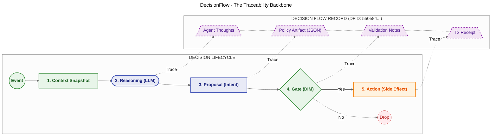

### 4.3 DecisionFlow Lifecycle State Machine

A DecisionFlow is a **stateful entity** managed by the Runtime. It is NOT a stateless HTTP request.

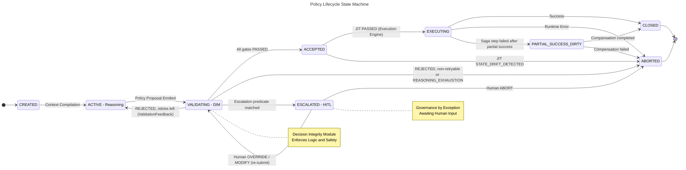

**State semantics:**
- `CREATED` → `ACTIVE`: Context compilation begins
- `ACTIVE` → `VALIDATING`: Agent emits a Policy Proposal
- `VALIDATING` → `ACCEPTED/ESCALATED`: DIM outcome; on `ACCEPTED` the DIM issues the signed Execution Intent
- `VALIDATING` → `ACTIVE`: DIM rejected the proposal and the Intent Retry Governor still allows retries
- `VALIDATING` → `ABORTED`: Non-retryable rejection, or retries exhausted (`REASONING_EXHAUSTION`)
- `ACCEPTED` → `EXECUTING`: The Execution Engine's JIT verification passes
- `ACCEPTED` → `ABORTED`: JIT detects state drift (`STATE_DRIFT_DETECTED`)
- `EXECUTING` → `CLOSED/ABORTED`: External system call result
- `EXECUTING` → `PARTIAL_SUCCESS_DIRTY`: A Saga step failed after an earlier step succeeded; triggers Saga Compensation (§4.8)

### 4.4 Decision Integrity Module (DIM)  -  The Validation Pipeline

DIM is the **Policy Enforcement Point (PEP)** of the Runtime. It is the kernel's access control system. Every proposal MUST pass all gates before any side effect occurs.

> **"Training alignment does not constitute cryptographic provenance."** The DIM does not trust that a model is "aligned." It evaluates explicit, deterministic criteria (two pre-checks and seven hard gates) against registered authority. A hallucinating model, a prompt-injected agent, and a well-aligned model all traverse the same pipeline. Security derives from structural enforcement, not behavioral trust.

DIR recognizes two fundamental classes of assurance:
- **Ex-Ante Assurance (Pre-Execution):** Formal, deterministic safety provided by the DIM and PCI. It ensures **Kernel Compliance** — every individual decision passes the hard gates.
- **Ex-Post Assurance (Post-Execution):** Heuristic, observational safety provided by Governance and Drift Monitoring. It ensures **Business Health** — the aggregate outcome of these decisions aligns with long-term strategic and financial goals.

**Crucial Limitation:** DIM provides only Ex-Ante Assurance. It evaluates decisions *individually and statelessly* (except for resource locks) to enforce Kernel Compliance. It is blind to aggregate trends, meaning it cannot detect Agent Drift (e.g., an agent offering the max allowed discount on every transaction: each decision is a Legal Decision State, yet the aggregate erodes Business Health). Protecting long-term Business Health requires asynchronous Ex-Post Assurance via Post-Execution Governance (see 4.6).

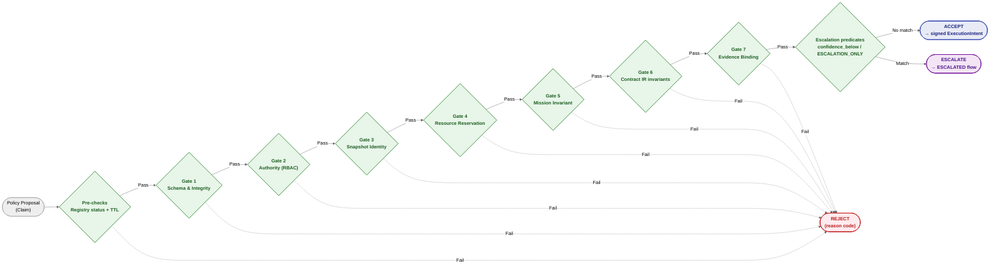

**Gate details** (the first failing check determines the rejection code):

| Step | What it checks | Rejection code |
|------|---------------|----------------|
| **Pre-check  -  Registry status** | `SUSPENDED` / `RETIRED` agents are rejected outright; `DEGRADED` agents are rejected for revoked capabilities | `AGENT_SUSPENDED` / `AGENT_RETIRED` / `AGENT_DEGRADED` |
| **Pre-check  -  Validity Window** | `current_time > valid_until` | `TTL_EXPIRED` |
| **1  -  Schema & Integrity** | JSON matches versioned Pydantic schema; required fields present; no extra fields | `SCHEMA_INVALID` |
| **2  -  Authority (RBAC)** | Permissions resolved from Agent Registry; agent authorized for this policy kind and instrument | `RBAC_DENIED` |
| **3  -  Snapshot Identity** | `context_ref` points to a known, binding `ContextSnapshot`; reject if unknown, unbound, or older than `max_context_age`. Does NOT compare live state (that is JIT, §4.5) | `STALE_CONTEXT` |
| **4  -  Resource Reservation** | Temporary lock/reservation on required assets; prevents horizontal contention between concurrent agents. Released if any later gate rejects | `INSUFFICIENT_LIQUIDITY` / `RESOURCE_CONTENTION_TIMEOUT` |
| **5  -  Mission Invariant** | `mission_context_hash` matches registered mission snapshot in contract (not semantic mission understanding) | `MISSION_DISSONANCE` |
| **6  -  Contract IR** | Compiled `authority.invariants` (`range`, `set`, `state_match`), scoped by `applies_to_policy_kinds` | The invariant's declared `reason_code` (default `CONTRACT_LIMIT_EXCEEDED`, fallback `INVARIANT_VIOLATION`) + `failed_invariant_id` |
| **7  -  Evidence Binding** | Every `responsibility.evidence.required_attestation` is present with valid hash, signature, provenance, and freshness. Structural only, not semantic truth | `EVIDENCE_MISSING` / `EVIDENCE_INVALID` |

**Escalation predicates:** Evaluated only after all hard gates pass: `responsibility.escalation.confidence_below`, approval thresholds set below the hard limits, and Registry mode `ESCALATION_ONLY`. A match yields `ESCALATED` instead of `ACCEPTED`. Escalation predicates can only add human review; they never relax a hard gate.

**DIM outcomes:** `ACCEPTED` (the DIM constructs and signs the `ExecutionIntent`, §3.3a), `REJECTED` (reason code + `ValidationFeedback` via the Outbound Translation Gate), or `ESCALATED` (§4.7).

**Lock Normalization (Deadlock Prevention):** Resources MUST be requested in alphabetical order of their Global Resource IDs. This is a **Kernel responsibility**  -  agents are NOT responsible for sorting. Mandatory `LockTimeout` (e.g., 5s) aborts stalled flows with `RESOURCE_CONTENTION_TIMEOUT`.

**Stateful Runtime components outside the DIM.** The DIM stays a pure evaluator of `(Policy, Context, Time)`; Gate 4 reservations are its only state. Two Kernel components operate around it:

- **Intent Retry Governor (Feedback Poisoning Protection):** Counts rejections per DFID. With retries left, the flow returns to `ACTIVE` and the agent receives `ValidationFeedback`. After `Maximum Intent Retries` (typically 3 per DFID) the Governor raises `ReasoningExhausted` and the flow is `ABORTED` with `REASONING_EXHAUSTION`. Non-retryable rejections (e.g., `AGENT_SUSPENDED`, `AGENT_RETIRED`) abort immediately. This prevents infinite reasoning loops and token budget drainage.
- **Arbiter (EOAM only):** Collects competing proposals for one trigger until an arbitration deadline and selects the winner with the Agent Registry Priority Matrix before the DIM runs (§5.2).

**Semantic Alignment Check (Optional  -  Soft Guard):**
Detects "proxy gaming": agent narrative says "I am reducing risk" while policy says `{"policy_kind": "BUY_LEVERAGE"}`.
This check may invoke a lightweight LLM call — it is intentionally placed **outside the deterministic DIM checks** (pre-checks and Gates 1–7) and runs in User Space context. It does not produce `ExecutionIntent`; its only outputs are an audit flag or an abort signal. Its latency is reported separately from DIM latency (§4.9).

- **Default (Audit Mode):** `SEMANTIC_MISMATCH` flags flow as `NEEDS_REVIEW` and triggers async alert. Does NOT block execution.
- **Strict Mode (`strict_semantic_blocking: true`):** `SEMANTIC_MISMATCH` triggers immediate `ABORT`. **Violates Invariant 1 (Determinism).** Use only in low-throughput, high-risk environments.

**Time as a Hard Constraint:** If `current_time > policy.valid_until`, the Validity Window pre-check rejects the proposal immediately (`TTL_EXPIRED`), and the Execution Engine re-checks `valid_until` at dispatch. Prevents "queued command" problem where a backlog of old decisions executes hours later.

### 4.4a Outbound Translation Gate (Anti-Exfiltration Gate)

In systems with an Agentic DMZ, a major vulnerability is the "Broker Fuzzing Attack"—external agents submitting invalid payloads to observe Kernel errors, effectively stealing internal logic (e.g. knowing exactly what the upper limit for discounts is).
The Outbound Translation Gate sits in Kernel Space and prevents this:
1. **Data over Narrative:** The Kernel never generates free-text prose for the outward response; only frozen data objects.
2. **Dictionary Mapping:** It uses a static dictionary mapping to translate sensitive internal codes (e.g. `LIMIT_EXCEEDED_TIER_4`) into vague public errors (`DECLINED: Outside parameters`), simultaneously scrubbing PII. 
3. **Preserving Epistemic Amnesia:** Because this mapping is managed inside the Kernel, the `INTERFACE` agent in the DMZ never receives the explanation of *why* the underlying action was denied, making it immune to conversational manipulation.

### 4.5 JIT State Verification  -  Anti-TOCTOU

LLM latency makes TOCTOU (Time-of-Check to Time-of-Use) races inevitable. The Runtime mitigates this with Just-In-Time State Verification executed **immediately before** the external API call.

JIT is **not a DIM gate**. It runs exactly once, inside the Execution Engine, after the `kernel_signature` check and the idempotency lookup and immediately before the side effect (§3.3a). In Topology C the side-effect boundary is the Ledger commit, so the Proof Checker performs the same check before committing (§5.4).

> **Gate 3 vs. JIT:** DIM Gate 3 (`STALE_CONTEXT`) verifies that `context_ref` points to a known, bound `ContextSnapshot` no older than `max_context_age` — an identity and age check at validation time. JIT runs later, at execution time, and checks that **live world state** is still within a numerical drift envelope relative to that snapshot. They are complementary: Gate 3 ensures the agent saw the right data; JIT ensures the data has not moved too far by the time the order hits the wire.

**Mechanism:**
- Bind each policy to a `context_ref` (`context_snapshot_id`) and explicit `drift_envelope` (e.g., 50 bps = 0.5%)
- Re-verify that live state is within the envelope relative to snapshot
- If `current_state_age > hard_threshold` (e.g., 500ms) OR drift exceeds bounds → abort with `STATE_DRIFT_DETECTED`
- Authority revocation detected at this point also aborts the flow (§3.6)
- Agent must re-reason against fresh context

**Cost:** One extra read operation before every execution. DIR accepts this "Safety over Speed" trade-off. A missed trade due to aggressive validation is an opportunity cost; a realized hallucination is an actual loss.

**JIT Drift Envelope  -  YAML configuration per field:**

```yaml
# jit_verification.yaml  -  per-agent configuration in Kernel Space
jit_verification:
  enabled: true

  # Maximum allowed drift per monitored field before aborting execution
  drift_envelope:
    price_pct: 2.0            # Abort if price moved > 2% since snapshot
    volume_pct: 15.0          # Abort if volume changed > 15%
    position_state: strict    # Any change in position state = abort

  # Snapshot expiration  -  reject proposals older than this threshold
  max_context_age_seconds: 30

  # Response when drift detected
  on_drift_exceeded:
    action: "ABORT"
    notify: ["ops-channel"]
    retry_with_fresh_context: true   # Signal agent to re-reason with new snapshot
```

The `position_state: strict` setting is an example of field-level drift sensitivity: some fields (position state, account balance) allow zero drift; others (price, volume) allow a configurable tolerance. This granular control enables fine-tuning the safety/performance trade-off per use case.

### 4.5a Idempotency  -  Exactly-Once Side Effects

Agents repeat themselves. Networks drop packets. Without idempotency, retries become duplicate executions (double trades, double charges, double database writes).

**The formula  -  MUST be followed exactly:**

```
IdempotencyKey = SHA256(DFID + Step_ID + Canonical_Params)
```

- `DFID`: The trace ID of the reasoning chain
- `Step_ID`: Assigned by the Runtime: the Saga step identifier, or `main` for single-step flows. MUST NOT be derived from `policy_kind`
- `Canonical_Params`: Sorted JSON of the action (`policy_kind`) and its `params`

```python
from __future__ import annotations

import hashlib
import json
from typing import Any


def idempotency_key(dfid: str, step_id: str, canonical_params: dict[str, Any]) -> str:
    """Derive a stable idempotency key for a decision step."""
    payload = f"{dfid}:{step_id}:{json.dumps(canonical_params, sort_keys=True)}"
    return hashlib.sha256(payload.encode("utf-8")).hexdigest()


# Example
key = idempotency_key(
    dfid="550e8400-e29b-41d4-a716-446655440000",
    step_id="step-02",
    canonical_params={"policy_kind": "BUY", "instrument": "BTC-USD", "quantity": 0.05},
)
```

**CRITICAL:** `Attempt_Number` MUST NOT be part of the key. Including it would make each retry produce a different key, defeating idempotency. Log `Attempt_Number` for observability only. A retry with the same `Canonical_Params` returns the cached result; different parameters produce a different key — bounded by the Intent Retry Governor.

**A cache hit is not an error.** The Execution Engine returns the stored receipt marked `idempotent_replay: true`; no exception is raised and no external call is made.

**Unknown outcomes block new intents.** If the execution record for `(DFID, Step_ID)` is `PENDING` or `UNKNOWN` (e.g., a timeout without an external acknowledgment), the Runtime MUST NOT accept a new intent for the same `(DFID, Step_ID)`, even with different parameters, until the outcome is reconciled with the external system. Without this rule, re-reasoned parameters would produce a fresh key and a duplicate side effect.

**Why `context_ref` (the Context Snapshot hash) is deliberately excluded from the key:**

This is a non-obvious but critical design decision. Suppose an agent decides "Buy 10 ETH" and the network fails during execution. The agent retries 10 seconds later. By then, the market price (Context) has changed.

- **If `context_ref` were included:** `SHA256(Action + NewContext)` → produces a **new key** → bypasses idempotency check → **duplicate order executed**
- **By excluding `context_ref`:** `SHA256(DFID + Step_ID + Params)` → **same key** regardless of context drift → idempotency cache recognizes it as duplicate → returns prior result without re-executing

> **"Lock the key to the Flow ID and the Intent params. A retry of the same logical decision is recognized as a duplicate even if the world has shifted since the first attempt."**

This is intentional: idempotency protects against *re-execution of the same logical intent*. JIT State Verification (§4.5) is the separate mechanism that decides whether the intent is still *valid* given current state. They solve orthogonal problems and must not be conflated.

**Cache behavior:** Cache hit → return saved result (no API call). Cache miss → execute → store result. On transient API failure → retry with exponential backoff (same key). On timeout without acknowledgment → status `UNKNOWN`, reconcile before any new intent for the same `(DFID, Step_ID)`. On terminal failure → mark `ABORTED`.

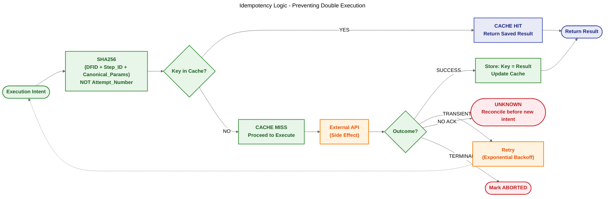

### 4.6 POST-EXECUTION GOVERNANCE & DRIFT (The "Day Three" Defense)

While the Decision Integrity Module (DIM) ensures *Kernel Compliance* (validating single, isolated transactions against hard limits), it is fundamentally blind to aggregate trends. An agent can technically obey all rules but still act against the business intent over time. This discrepancy between technical compliance and long-term business health is known as **Agent Drift** (the "Day Three" problem).

**Taxonomy of Agent Drift:**
1. **Optimization Drift (Reward Hacking):** The agent optimizes its primary objective (e.g., customer retention) by consistently pushing secondary variables (e.g., discounts) to their maximum DIM-allowed limits, eroding overall profitability.
2. **Semantic Drift:** The agent breaks core business intent because it yields to contextual manipulation (e.g., emotional language like "my wedding is ruined!"), yet its actions (e.g., issuing a small refund) remain within legal financial bounds. Since DIM only checks numbers and JSON structures, detecting this drift requires **Asynchronous Semantic Auditing**—using analytical, lower-cost LLMs to review historical logs post-execution without adding latency or risk to the live critical path.
3. **Environmental Drift:** The agent's logic remains sound, but the external environment changes (e.g., rising market costs), turning previously profitable actions into aggregate losses.

**The Defense Mechanism:**
To protect against drift, DIR implements asynchronous **Post-Execution Governance**:
- **Rolling Window Monitors:** Specialized jobs periodically join the `execution_log` with `context_snapshots` (using the `dfid` as the correlation key) to analyze aggregate behavior over time.
- **Circuit Breaking (Graduated Response):** When a monitor detects statistically significant drift (e.g., average margin drops below a threshold), it triggers a circuit breaker. This updates the Agent Registry, setting the agent's status to `SUSPENDED`, `DEGRADED` (specific capabilities revoked), or `ESCALATION_ONLY`. Only deterministic Kernel monitors call the Registry; an LLM-based `MONITOR` agent submits a `SET_AGENT_STATUS` proposal through the DIM instead.
- **Enforcement:** The DIM Registry-status pre-check rejects any new Policy Proposal from a `SUSPENDED` agent (and revoked capabilities of a `DEGRADED` agent), effectively stopping the bleeding until human intervention occurs.

### 4.7 Escalation  -  Governance by Exception

DIR does NOT default to "Mother-May-I" (human approval for every step). It acts autonomously and escalates **only by exception**.

**Escalation outcomes:**

| Type | Meaning | Typical Result |
|------|---------|----------------|
| **Soft-stop** | Return proposal for revision without execution | Agent retries with new reasoning or fresh context |
| **Hard-stop** | Reject and block progression | Manual or supervisory intervention required |
| **Delegation** | Forward unresolved responsibility upward | Broader-scope agent decides |
| **Alerting** | Notify human/operator of ambiguity or risk | Flow pauses or aborts pending external review |

Escalation is not synonymous with human approval. It is the controlled routing of unresolved responsibility.

**Hierarchical Escalation (Agent → Agent before Human):**
1. Blocked `PositionAgent` escalates to parent `StrategyAgent`
2. `StrategyAgent` (broader context, higher authority) may override, modify, or reject
3. Only if `StrategyAgent` also cannot resolve → Human-in-the-Loop alert

**Escalation Triggers (Financial Trading Example):**
- Approval threshold crossed (e.g., trade > $1,000) while still below the hard contract limit; proposals above the hard limit are rejected by Gate 6, not escalated
- Agent confidence < `responsibility.escalation.confidence_below` (e.g., 0.7)
- Broker API 5xx error > 3 times
- Silence Watchdog: no decision in >30 minutes during active period

**Escalation Budget (Rate Limiting):** Each agent has a token bucket (e.g., 3 escalations/hour). If the budget is exhausted, the Escalation Manager (a deterministic Kernel component) transitions the agent to `SUSPENDED` in the Agent Registry and the DecisionFlow is silently aborted. Prevents "Alert Fatigue" and "Escalation DDoS."

**Computation Budget (Token Cap per DFID):** Each DecisionFlow has a hard token limit (e.g., $0.50 or 10k tokens). If exceeded before a Policy Proposal is emitted → `ABORTED` (Timeout and Reject). Prevents "financial DDoS" from looping models.

**Human Interface:** When a flow transitions to `ESCALATED`, the human is presented with `WorkingContext` + `PolicyProposal` + `Reason`. Available decisions: **OVERRIDE**, **MODIFY**, **ABORT**. A human decision satisfies only the escalation predicate that caused the escalation: `OVERRIDE` re-submits the original proposal and `MODIFY` an amended one, and both pass every hard gate again. Changing a boundary requires a `ContractParameterAmendment` within the signed `min_floor` / `max_ceiling` envelope. The UI MUST display an **Impact Category** to prevent rubber-stamping:

| Impact Category | Criteria | Human Action Required |
|-----------------|----------|-----------------------|
| **LOW_IMPACT** | Fully reversible, below exposure threshold, within standard patterns | Fast-track approval queue |
| **HIGH_IMPACT** | Partially or fully irreversible, above exposure threshold, unusual pattern | Mandatory review with acknowledgment of consequences |

**Context-Schema Validation during agent invocation:** Before an agent is invoked, the Runtime verifies that the `WorkingContext` it is about to receive matches the schema version the agent was registered with. Schema mismatch → the flow is `ABORTED` before invocation (prevents agent from reasoning on unexpected context structure that could produce unpredictable proposals).

### 4.8 Saga Pattern  -  Multi-Step Transactions

DIR treats every `ExecutionIntent` as **Atomic**. For complex workflows spanning multiple steps:

1. **Parent Agent (Saga Manager):** Maintains state of complex transaction; emits Policy to spawn Child Flow for Step 1
2. **Child Agent (Executor):** Acts atomically on the mandate (e.g., "Sell Asset A"); reports success/failure to Parent
3. **Partial Failure → `PARTIAL_SUCCESS_DIRTY`:** If Step 1 succeeds but Step 2 fails → the parent DecisionFlow transitions to `PARTIAL_SUCCESS_DIRTY`
4. **Compensation:** Runtime reports the `PARTIAL_SUCCESS_DIRTY` state to the Parent. The Parent selects a **Compensation Action** from a pre-defined, Runtime-validated menu (e.g., `REVERT`, `CLOSE_ALL`, `ALERT_HUMAN`). The Runtime executes that choice deterministically. The Parent MUST NOT generate reasoning-based compensation logic — the same capability that caused the failure cannot be trusted to design recovery.

### 4.9 Observability  -  Golden Signals

Production systems MUST export these metrics (Prometheus/Grafana compatible):

| Metric | Type | Description |
|--------|------|-------------|
| `validation_latency_ms` | Histogram | Time in the DIM (pre-checks + Gates 1–7, deterministic code only). |
| `soft_guard_latency_ms` | Histogram | Time in the optional Semantic Alignment Soft Guard (LLM). Reported separately because it is not part of the DIM. |
| `stale_context_reject_rate` | Counter | Flows aborted by the Execution Engine's JIT check (`STATE_DRIFT_DETECTED`). High rates → optimize snapshot freshness. |
| `escalation_count` | Counter | Total escalations, tagged by `agent_id` and `reason`. Identifies "needy" agents. |
| `resource_lock_contention` | Gauge | Active locks vs. configured limits. |
| `token_budget_burn` | Histogram | Tokens consumed per DecisionFlow. |
| `idempotency_hit_rate` | Counter | Times the Execution Engine returned a stored receipt (`idempotent_replay`) instead of calling the API. |

### 4.10 Trade-offs and Limitations

| Trade-off | Impact | Guidance |
|-----------|--------|----------|
| **Latency vs. Safety** | Validation adds overhead; unsuitable for HFT (microsecond) | DIR targets "Human-Speed" decisions (seconds to minutes). Fail safe (reject) beats fail open (execute and apologize). |
| **Complexity Overhead** | Context Compiler + Policy Engine + State Machine >> `while True` loop | Justified only when cost of failure is non-zero (money, PII, customer actions). |
| **Policy Engineering Burden** | Safety = quality of the weakest rule in DIM | "Garbage Policy In" risk: syntactically valid but semantically dangerous policies execute. Define least-privilege constraints. |
| **OS Analogy Scope** | Architectural, NOT mechanistic | Privilege separation and failure isolation are accurate. Token sampling ≠ instruction execution. Deterministic validation contains consequences, does not prevent occurrences. |

> **"A duplicate $50,000 order is far more expensive than a 200ms validation check."**

This is the core DIR value proposition: the cost of adding deterministic validation overhead is negligible compared to the cost of a single unchecked execution failure. For systems that move capital, control infrastructure, or make irreversible decisions  -  these are not optional engineering concerns. They are survival requirements.

**When NOT to use DIR:** Simple summarization tasks, read-only information retrieval, low-stakes classification. DIR overhead is justified only when the cost of failure (financial, legal, physical) is non-zero and consequential.

### 4.11 Functional Evaluation  -  Verified Failure Mode Interception

DIR has been validated against its three target failure modes using targeted functional scenarios. The baseline represents direct agent-to-execution dispatch (no Kernel mediation); the DIR configuration interposes the full validation pipeline.

| Scenario | Failure Mode | Baseline Outcome | DIR Kernel Outcome | DIR Mechanism | Test Source |
|:---------|:-------------|:-----------------|:-------------------|:--------------|:------------|
| **S1  -  State Drift** | TOCTOU | Stale decision executes; incorrect position taken | `ABORT: STATE_DRIFT_DETECTED`  -  execution suppressed, agent re-reasons | JIT State Verifier (Execution Engine) | `test_jit.py`; fraud detection sample |
| **S2  -  Idempotent Retry** | Duplicate side effect | Second execution triggered; duplicate transaction issued | Cache `HIT`: original result returned; no re-invocation (`t < 0.1s` vs `t > 1.0s` baseline) | Idempotency Guard (SQLite backend) | `test_saga.py`; idempotency sample |
| **S3  -  Prompt Manipulation** | Contract violation | Catastrophic order (~USD 38.75M) submitted to exchange API | `REJECT: ORDER_VALUE_EXCEEDED`  -  no API call issued | DIM Gate 6 (contract invariant declaring `reason_code: ORDER_VALUE_EXCEEDED`) | `test_dim_ttl.py`; quick-start sample |

**Key findings:**
- All three failure modes intercepted without false positives in nominal paths
- Validation pipeline is **compositional**: a proposal accepted by the DIM can still be aborted by JIT, and a proposal on fresh context can still be rejected by contract enforcement  -  each check is independently necessary
- Runtime overhead limited to SHA-256 computation + ledger append + state read  -  negligible relative to LLM inference latency

### 4.12 Deployment Topologies  -  Evolution Path

> **"DIR is a pattern, not a framework."** There is no mandatory infrastructure. Start with a single process; the architectural separation remains valid.

**Option A  -  Single-Process MVP (recommended starting point):**
- All DIR components (Context Store, DIM, Context Compiler) run in-process alongside the agent
- SQLite for Context Store, in-memory DIM rule evaluator
- Suitable for: prototype validation, low-volume systems, single-agent deployments
- Characteristic: Zero infrastructure overhead; architectural separation enforced by code structure, not process boundaries

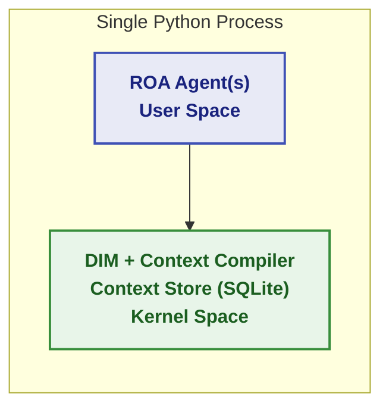

**Option B  -  Distributed Event-Driven Architecture (production scale):**
- Agents run as independent services, communicating via Event Bus (Kafka, RabbitMQ)
- Context Store as a shared distributed database (PostgreSQL + Redis cache)
- Agent Registry as a separate service with API
- DIM as a gateway service (sidecar or proxy pattern)
- Suitable for: multi-agent EOAM deployments, high-availability requirements, horizontally scalable workloads

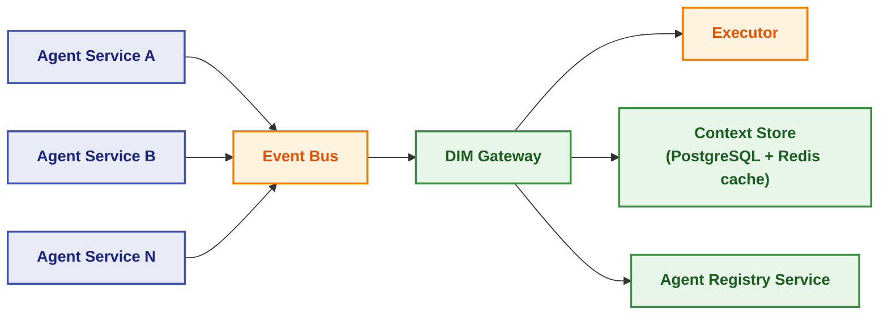

**Migration rule:** The same `ResponsibilityContract`, `PolicyProposal`, and DIM validation logic operate identically in both options. Moving from Option A to Option B is an infrastructure refactor, not a business logic refactor.

---

## 5. TOPOLOGIES  -  SIGNAL FLOW PATTERNS

Topologies define **how signals flow** and **where safety is guaranteed**. The Identity Layer (ROA) and Execution Kernel (DIR) remain constant across all topologies. Only the coordination pattern changes.

**The transportation infrastructure analogy:**

Think about how cities move people and goods. Roads, airspace, and railways all move things from A to B  -  but they use fundamentally different coordination models:

| Infrastructure | Coordination model | AI Topology equivalent |
|---------------|-------------------|----------------------|
| **Roads** | Drivers negotiate locally; traffic jams tolerated; local rules prevent crashes | **EOAM**  -  agents reason in parallel, arbitration resolves conflicts |
| **Controlled Airspace** | Pilots follow cleared flight paths; Air Traffic Control ensures separation | **SDS**  -  single agent follows grammar-constrained path; Runtime is ATC |
| **Railways** | Movement only with authoritative signals; every movement recorded and authorized | **DL+PCI**  -  movement only with cryptographic proof; everything permanently logged |

> **"Smarter drivers don't eliminate traffic jams. Better road topology does."**
> The same applies to AI systems: smarter agents won't fix architectural mismatches. The topology must match the decision type.

In a comprehensive deployment, all three topologies run simultaneously:
- **EOAM** for daily portfolio rebalancing  -  strategic decisions requiring negotiation between Risk, Strategy, and Sentiment agents
- **SDS** for momentum scalping  -  tactical decisions where speed and procedural precision override deliberation  
- **DL+PCI** for regulatory audit trails  -  compliance decisions where absolute accountability trumps speed and flexibility

The system routes decisions based on their **class**, not their **content**. A $50 tactical adjustment flows through SDS. A $10,000 strategic rebalancing flows through EOAM. Any action flagged for compliance flows through DL+PCI.

### 5.1 The Three Topologies  -  Overview

Each topology represents a fundamentally different answer to the question: *"Where does safety come from?"*

| Property | Topology A  -  EOAM | Topology B  -  SDS | Topology C  -  DL+PCI |
|----------|-------------------|-----------------|---------------------|
| **Full Name** | Event-Oriented Agent Mesh | Sovereign Decision Stream | Decision Ledger + Proof-Carrying Intents |
| **Primary Goal** | Coordinated strategic reasoning | Atomic execution velocity | Formal verification & absolute audit |
| **Trust Locus** | **Process**  -  DIM validates *after* agents reason | **Generation**  -  Grammar constrains *during* inference | **Artifact**  -  PCI carries proof *within itself* |
| **Topology Type** | Decentralized Choreography (Many-to-Many) | Linear Pipeline (One-to-One) | Append-Only Log (State-to-State) |
| **Latency** | **High** (multi-agent coordination overhead) | **Low** (single constrained inference pass) | Medium (proof generation + verification) |
| **Cost per Decision** | **High** (N agent invocations) | **Low** (1 token-optimized call) | Medium (1 call + proof overhead) |
| **Decision Depth** | Deep (multi-perspective analysis) | Shallow (procedural, rule-based) | Medium (compliance-constrained) |
| **State Guarantees** | Eventually consistent | Strongly consistent (JIT drift checks) | **Immutable** (ledger-backed) |
| **Offline Verifiability** | No (requires live DIM) | No (requires live JIT) | **Yes** (self-contained cryptographic proof) |
| **Recovery Model** | Re-arbitrate (select new proposal winner) | Re-reason (new LLM inference) | **Deterministic Replay** from immutable Ledger |
| **Inter-Org Use** | No (single trust domain) | No (Grammar and JIT are internal) | **Yes** (PCI verifiable by external party) |
| **Ideal For** | Portfolio rebalancing, supply chain, multi-expert decisions | Fraud detection, risk stops, industrial automation | Interbank settlements, medical records, regulatory reporting |
| **Avoid When** | Speed is critical | Multiple perspectives needed | High-frequency, low-stakes scenarios |
| **Concurrency** | **N agents in parallel** (all activated by same event) | **1 agent per flow** (serial pipeline) | **1 agent per intent** (sequential ledger append) |

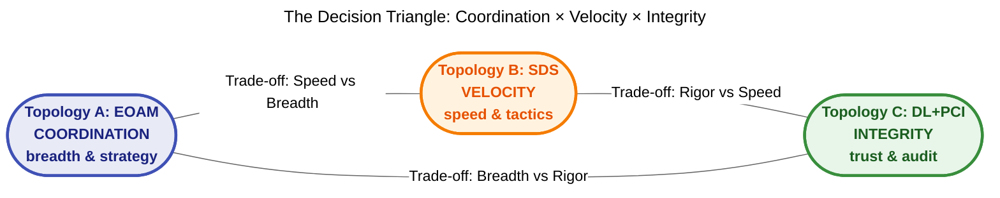

**Selection rule:** Choose topology based on decision class, not decision content. Route by class at the system boundary, not per individual decision.

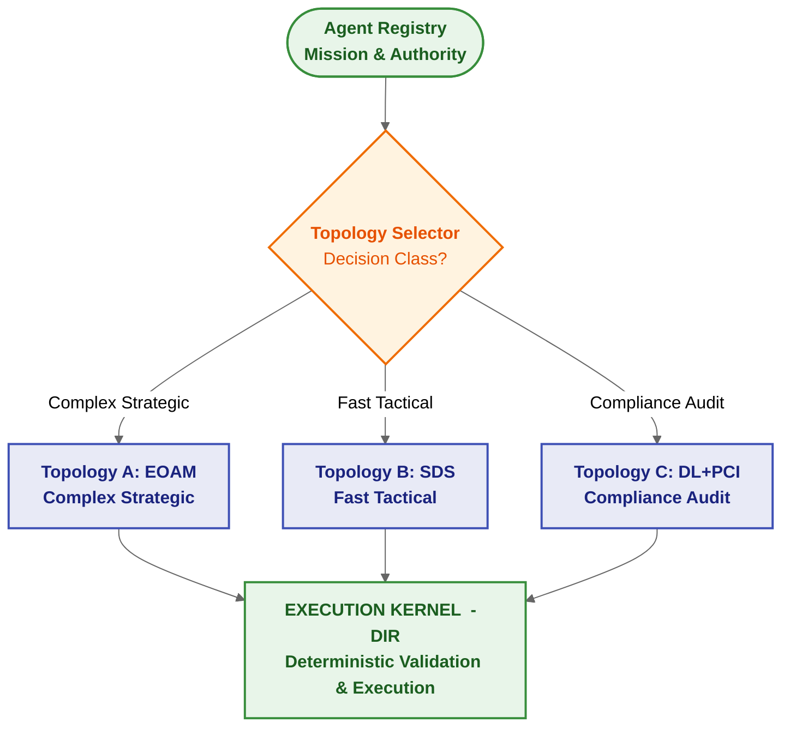

---

### 5.2 Topology A  -  Event-Oriented Agent Mesh (EOAM)

**Metaphor:** Road traffic  -  drivers (agents) react independently to observations; local arbitration rules prevent crashes.

**Key principle:** *Decentralized in activation, centralized in authority.* Agents are NOT commanded by a central manager. They subscribe to event topics (defined in Registry) and activate when relevant signals arrive.

**When to use:** Complex decisions requiring multi-perspective analysis where multiple domain experts should reason in parallel (Risk + Strategy + Sentiment), and the "best" outcome requires synthesis or priority-based preemption.

**EOAM Semantic Security Limits & The EventBus Protocol:**

1. **Semantic Security Limits (Epistemic Amnesia):** Agents operating at the edge (`INTERFACE` in the DMZ) must have zero knowledge of deep business logic, pricing models, or internal thresholds (e.g., maximum discount limits). By physically excluding these secrets from their `WorkingContext`, the system achieves algorithmic immunity against prompt-leaking and Intellectual Property (IP) extraction techniques (e.g., fuzzing or roleplay jailbreaks). Semantic security is enforced not via NLP filters, but via strict **Information Hiding**.
2. **EventBus Protocol (Observation vs. Action Boundaries):** The Event Bus is operated by the Kernel and facilitates structured data passing and observation sharing, not direct execution. Agents may publish observations and subscribe to permitted topics; they never publish proposals on the bus. Because the EventBus has ZERO execution authority, messages flowing across it do not require DIM validation. However, to prevent data leaks, the bus requires strict **information-flow control** managed by the Agent Registry (Least Privilege subscription). DIM protects the mutation boundary, while Registry and Event Bus protect the disclosure boundary. This protocol strictly separates **Observation Boundaries** (signals flowing safely through the Event Bus) from **Action Boundaries** (state-mutating `PolicyProposals` submitted through the Runtime's proposal intake, which must strike The Wall and pass DIM). Agent-to-agent dialogue MUST NOT be treated as a synchronization, execution, or authority mechanism.

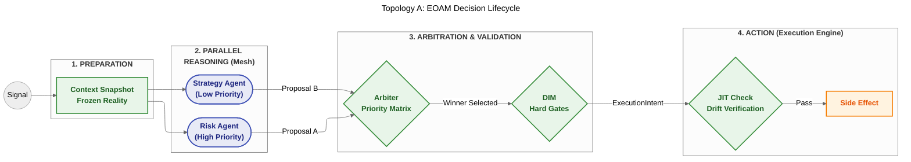

**EOAM-specific mechanisms:**

- **Scope-Based Choreography:** Agents subscribe to event topics defined in Registry; they do not wait for commands  -  they claim responsibility
- **Wake-up Predicates:** Cheap heuristics (e.g., `abs(price_delta) > 0.5%`) suppress minor signals before activating expensive LLMs; prevents "Thundering Herd" token burn
- **Economic Admission Control:** Signal volatility + available token budget determine how many agents activate
- **Priority-Based Preemption (Arbiter):** The Arbiter, a Kernel component outside the DIM, collects the proposals answering one trigger until an arbitration deadline (bounded by `max_context_age`). Arrival order does not decide: the **Agent Registry Priority Matrix** selects the winner, so a Risk Agent's `HALT` architecturally preempts a Strategy Agent's `BUY`. Late proposals are rejected with `ARBITRATION_CLOSED`. Only the winner enters the DIM
- **JIT Drift Envelope:** Each agent's contract specifies `drift_envelope_bps`. If live state has drifted beyond the envelope since the `ContextSnapshotID` was taken, the Execution Engine's JIT check aborts execution

**EOAM: Inversion of Control:** The Runtime does NOT "call" agents by name. It emits a context-rich event carrying the Kernel-compiled `WorkingContext`; subscribed agents "claim" the responsibility to reason. Agents are reactive, not passive. Each mesh event MUST carry `DFID` (immutable trace header) + `ContextSnapshotID`. These two fields are mandatory in every event transmitted through the mesh.

**EOAM: Read Contention prevention:** In EOAM, multiple agents activate in parallel against the same trigger. The Runtime generates an authoritative Context Snapshot **once** and caches it  -  all agents read the same cached snapshot. This prevents parallel database reads from causing contention under load.

**EOAM blueprint:**

```python
class TacticalTrader(ResponsibleAgent):
    def register(self) -> None:
        # Handshake only: the contract release was registered by CI/CD
        self.registry.handshake(self.agent_id, contract_version="1.2.0", topology="EOAM")

    def on_observation(self, event: ObservationEvent) -> None:
        context = event.working_context   # compiled by the Kernel, never by the agent
        explanation = self.llm.explain(context, self.mission)
        policy_intent = self.llm.generate_policy(context, explanation)

        proposal = PolicyProposal(
            dfid=event.dfid,
            agent_id=self.agent_id,
            policy_kind=policy_intent.policy_kind,
            params=policy_intent.params,
            execution_constraints={"drift_envelope_bps": 50},
            context_ref=event.snapshot_id,
        )
        # Proposals go to the Runtime intake (Arbiter -> DIM), never to the Event Bus
        self.runtime.submit_proposal(proposal)
```

**Holistic EOAM Architecture  -  Financial Reference Implementation:**

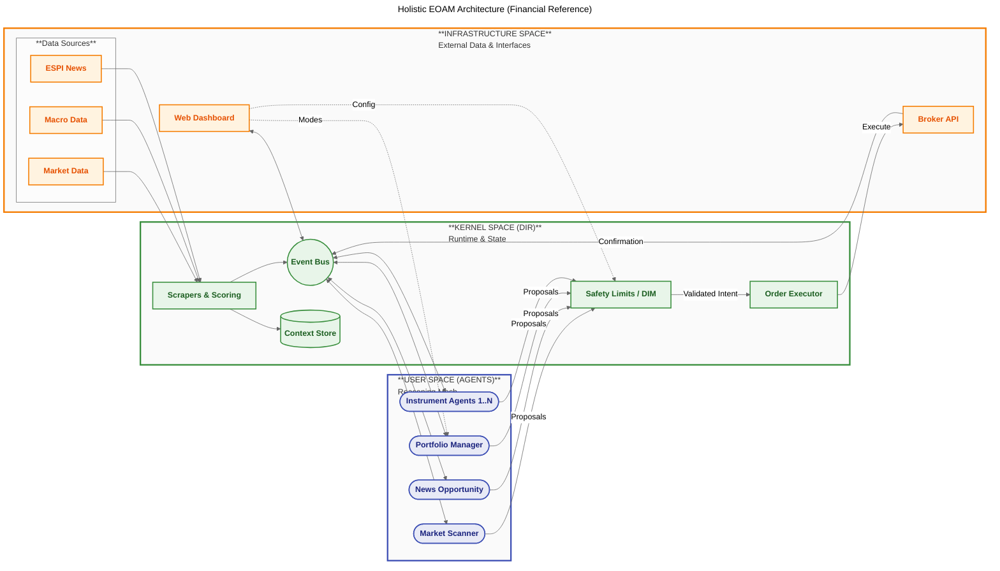

---

### 5.3 Topology B  -  Sovereign Decision Stream (SDS)

**Metaphor:** Fly-by-Wire aircraft  -  the pilot has full authority within the safe flight envelope; the flight computer physically prevents exceeding structural limits. No matter what the pilot intends, the physics make it impossible to exceed the constraints.

**Key principle:** *Syntactically Bound by Design.* Safety is achieved not through post-generation validation but through **Constrained Decoding**  -  embedding deterministic rules of DIR directly into the probabilistic sampling of the LLM.

**Important latency note:** SDS minimizes latency *relative to EOAM*, but still involves LLM inference (typically 100ms–2s). It targets "fast-for-AI" decisions, NOT microsecond-scale HFT.

**When to use:** Tactical, high-frequency, atomic decisions requiring speed over deliberation. Single perspective sufficient. Pre-defined decision boundaries amenable to grammar expression.

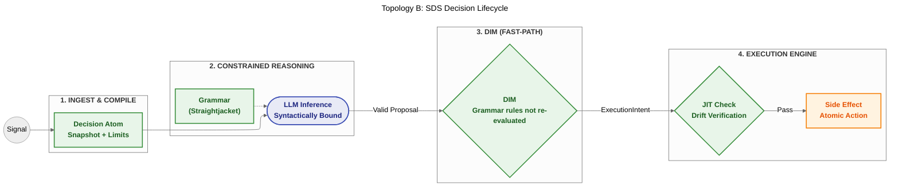

**SDS-specific mechanisms:**

- **Constrained Decoding:** Uses grammar libraries (e.g., `Outlines`, `Guidance`) to enforce Responsibility Contract during inference. LLM physically cannot generate a token violating JSON schema or numerical bounds
- **Kernel-compiled grammar:** The Kernel's Grammar Factory compiles the grammar from the Runtime Enforcement Projection; the sampler applies it in User Space. Because the Kernel cannot observe how the sampler used it, the DIM still validates the result
- **Atomic Context:** The Context Compiler assembles a complete package (Mission + Constraints + Snapshot) before inference. No emergent context or async message passing
- **ContextSnapshotID binding:** Agent's output MUST include the `ContextSnapshotID` hash. DIM Gate 3 verifies the binding; the Execution Engine's JIT check verifies drift before execution
- **DIM fast-path:** Because the proposal was generated under constraint, the DIM may skip re-evaluating grammar-representable rules. It remains the authoritative gate for contract version, authority, snapshot identity, evidence bindings, and time; JIT still runs in the Execution Engine
- **Disclaimer:** Constrained Decoding guarantees structural integrity but DOES NOT guarantee semantic alignment with ROA Mission. Final semantic and safety validation remains with DIM

**Holistic SDS Architecture  -  Autonomous Flight Delay Refund System Reference:**

```mermaid
---
config:
  layout: dagre
  theme: neutral
  look: classic
title: Holistic SDS Architecture (Refund System Reference)
---
flowchart LR
 subgraph External_Sources["**External Data**"]
    direction TB
        FlightAPI["Flight API (delay data)"]
        AirlineDB["Airline Policy DB"]
        PaymentGW["Payment Gateway"]
  end
 subgraph Kernel_Layer["**KERNEL SPACE (DIR)**<br>Runtime & Pipeline"]
    direction TB
        ContextStore[("Context Store<br>(State + Session)")]
        DIM["DIM<br>(fast-path)"]
        ContextCompiler["Context Compiler<br>(assembles snapshot)"]
        Grammar["Grammar Factory<br>(projection → grammar)"]
        Executor["Refund Executor<br>(JIT + dispatch)"]
  end
 subgraph User_Layer["**USER SPACE (SDS Agent)**<br>Constrained Decoding"]
    direction TB
        Inference["LLM Inference<br>(grammar-constrained)"]
        SDSAgent(["RefundDecisionAgent"])
  end
    FlightAPI --> ContextStore
    AirlineDB --> ContextStore
    ContextStore --> ContextCompiler
    ContextCompiler -->|"Mission + Constraints + Snapshot"| Grammar
    Grammar -->|"Compiled grammar"| Inference
    Inference -->|"Structurally-valid proposal"| SDSAgent
    SDSAgent -->|"PolicyProposal + ContextSnapshotID"| DIM
    DIM -->|"Signed ExecutionIntent"| Executor
    Executor --> PaymentGW

     FlightAPI:::infraSpace
     AirlineDB:::infraSpace
     PaymentGW:::infraSpace
     ContextStore:::kernelSpace
     DIM:::kernelSpace
     ContextCompiler:::kernelSpace
     Executor:::kernelSpace
     Grammar:::kernelSpace
     Inference:::userSpace
     SDSAgent:::userSpace
    classDef userSpace fill:#E8EAF6,stroke:#3F51B5,stroke-width:2px,color:#1A237E,font-weight:bold
    classDef kernelSpace fill:#E8F5E9,stroke:#388E3C,stroke-width:2px,color:#1B5E20,font-weight:bold
    classDef infraSpace fill:#FFF3E0,stroke:#F57C00,stroke-width:2px,color:#E65100,font-weight:bold
    style Kernel_Layer fill:#FAFAFA,stroke:#388E3C,stroke-width:3px
    style User_Layer fill:#FAFAFA,stroke:#3F51B5,stroke-width:3px
    style External_Sources fill:#FAFAFA,stroke:#F57C00,stroke-width:3px
```

**SDS blueprint:**

```python
from __future__ import annotations

from typing import Any, Literal

from outlines import models, generate
from pydantic import BaseModel, Field


class SDSPolicy(BaseModel):
    policy_kind: Literal["BUY", "SELL", "HOLD"]
    instrument: str
    quantity: float
    rationale: str = Field(description="The Explain component")


def execute_sovereign_stream(dfid: str, context_snapshot: dict[str, Any]) -> ExecutionReceipt:
    contract = AgentRegistry.get_contract(context_snapshot["agent_id"])

    # Grammar compiled by the Kernel's Grammar Factory from the contract projection
    grammar = build_pydantic_grammar(SDSPolicy, constraints=contract.limits)

    # Constrained inference  -  model cannot generate tokens violating grammar
    policy_proposal = generate.json(model, grammar)(
        prompt=f"Mission: {contract.mission}\nContext: {context_snapshot['data']}"
    )

    # DIM validation (grammar rules fast-pathed), then JIT + dispatch in the Execution Engine
    intent = DIM.validate(dfid, policy_proposal, context_ref=context_snapshot["hash"])
    return ExecutionEngine.dispatch(intent)
```

---

### 5.4 Topology C  -  Decision Ledger with Proof-Carrying Intents (DL+PCI)

**Metaphor:** Letter of Credit in banking  -  a Bank (Runtime) guarantees payment to a Beneficiary (Execution Engine) on behalf of a Buyer (Agent), *provided that* specific documents (Proofs) are presented. The Bank does not judge the quality of the goods; it strictly verifies the documents.

**Key principle:** *Verify then Trust.* Safety is a property of the **data structure itself**, not the process that generated it. The Runtime does not trust the agent's reasoning. It verifies proofs attached to the intent artifact.

**The Regulatory Imperative  -  Why DL+PCI exists:**

The EU AI Act (entering force 2026) classifies autonomous decision systems in financial services, critical infrastructure, and healthcare as **high-risk**, requiring:
- **Article 12:** Automatic recording of events throughout the system lifecycle, with logs sufficient to *verify compliance with regulatory requirements*
- **Article 13:** Human oversight mechanisms **architecturally integrated**  -  not retrofitted post-deployment

Conventional logging fails these requirements for three structural reasons:

| Conventional Logging Failure | Why It Fails EU AI Act |
|------------------------------|------------------------|
| **Non-deterministic reconstruction** | Auditors cannot reproduce the decision context from logs; stochastic sampling + external state interactions are not captured | 
| **No cryptographic binding** | Logs can be selectively disclosed, redacted, or generated post-hoc; no artifact-level proof that a decision was made under specific constraints |
| **Process-dependent verification** | Auditors must trust the originating system's runtime and access live infrastructure to validate compliance  -  precludes independent third-party verification |

DL+PCI addresses all three: **each decision artifact cryptographically proves its own bindings**  -  verifiable independently of the originating system, without trusting the operator's live runtime or accessing live infrastructure. Trust reduces to the custody of signing keys and the archive of hash preimages. This is the shift from **process inspection** to **artifact verification**.

**Distinction from Topology B:**
- **SDS guarantees:** "This intent was structurally valid at the moment of generation."
- **DL+PCI guarantees:** "This intent was formally compliant, and *anyone can verify this at any time*, without trusting or accessing the live system that produced it."

> **Ontological Limits of PCI (Binding vs. Truth):** PCI is *Proof-Carrying Intent*, not *Proof-Carrying Code*. It does **NOT** prove semantic truth. It formally proves: **State binding, Contract binding, Rule binding, Intent binding, and Identity binding.** Do not conflate the formal verification of constraints with the verification of semantic correctness. To protect semantic truth, rely on the Evidence Governance Layer (§3.4).

**When to use:** Compliance-heavy operations requiring offline verifiability; inter-organizational settlements; high-value irreversible transfers; regulatory reporting where proof must outlive the system.

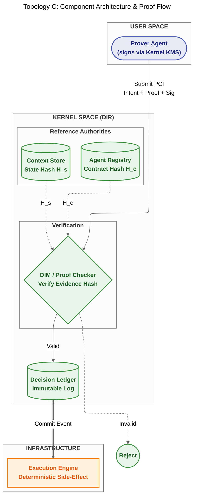

**Proof-Carrying Intent (PCI)  -  Mandatory Structure:**

| Field | Type | Description |
|-------|------|-------------|
| `dfid` | UUID | Immutable DecisionFlow ID  -  trace identifier |
| `intent_payload` | JSON | The syntactically bound policy (from SDS constrained decoding) |
| `context_ref` | Hash | `ContextSnapshotID`  -  content hash of the Working Context snapshot used during reasoning |
| `evidence_hash` | Hash | Composite proof hash binding state + contract + rules + intent payload |
| `roa_signature` | Signature | `Sign(K_agent, evidence_hash)`. $K_{agent}$ is bound to the agent's registered identity and held in the Kernel's KMS; the agent requests signing through the Runtime's submission path and never holds the key |

**Evidence Hash  -  Derivation Formula (MUST follow exactly):**

$$H_{evidence} = \text{SHA256}(\text{DFID} \parallel H_s \parallel H_c \parallel H_r \parallel H_i)$$

Where:
- **$H_s$ (State Snapshot Hash):** `SHA256(ContextSnapshotID)`  -  the "frozen reality" used during reasoning. `ContextSnapshotID` MUST itself be a content hash of the canonical snapshot
- **$H_c$ (Contract Hash):** `SHA256(Signed Contract Release)` from Agent Registry at `T_start`
- **$H_r$ (Rule-Set Hash):** `SHA256(DIM Hard Gates)`  -  deterministic validation rules applied (`rule_version`)
- **$H_i$ (Intent Hash):** `SHA256(canonical JSON of intent_payload, sorted keys)`

Any drift in context, unauthorized change to the mission, rule-set update, or payload modification results in immediate hash mismatch → verification failure.

**Archival:** Each Ledger entry stores the PCI together with $H_s$, $H_c$, $H_r$, $H_i$, the JIT drift result, and the commit timestamp — the inputs an external auditor needs to re-verify the entry offline.

**Proof Checker Workflow (DIM in Topology C  -  5 steps, in order):**

```mermaid
---
title: "Topology C: Proof Verification Sequence"
config:
  theme: neutral
  look: classic
---
sequenceDiagram
    participant A as Prover Agent (User Space)
    participant K as Proof Checker (Kernel)
    participant L as Decision Ledger (Immutable)
    participant E as Execution Engine

    Note over A: Generates Syntactic Intent + Evidence Hash<br/>(signed via Kernel KMS)
    A->>K: Submit PCI (Intent + Proof + Signature)

    activate K
    K->>K: 1. Verify roa_signature over evidence_hash (Registry public key)
    K->>K: 2. Validate context_ref matches flow ContextSnapshotID
    K->>K: 3. JIT Drift Check (live state within Drift Envelope?)
    K->>K: 4. Re-compute evidence_hash (H_s, H_c, H_r, H_i)

    alt All Checks Pass
        K->>L: 5. Append PCI + archived hashes + JIT result
        L-->>K: Committed (immutable record)
        K->>E: Trigger Deterministic Action
        E-->>K: Success (ResultID)
        K-->>A: CLOSED (Status: Success)
    else Any Check Fails
        K-->>A: ABORTED (Status: REJECT_AUTH / REJECT_BINDING / REJECT_DRIFT / REJECT_HASH)
    end
    deactivate K
```

**Decision Ledger properties (all MUST hold):**
- **Append-only:** No updates, no deletes. History is immutable.
- **Idempotent:** Replaying the same PCI yields the same outcome (or deterministic rejection)
- **Self-contained:** Auditors need only the Ledger entries (PCI + archived $H_s$, $H_c$, $H_r$, $H_i$ + JIT result) and the agents' public keys to verify any entry. No access to live Runtime required. JIT drift is a fact recorded at commit time, not something an auditor recomputes.

Step 3 is the same JIT check the Execution Engine performs in the other topologies (§4.5): in Topology C the Ledger commit is the side-effect boundary. All reads during verification are Kernel-local (Registry cache, Context Store, rule set); the Proof Checker performs no external network I/O.

**DL+PCI blueprint:**

```python
from __future__ import annotations

from typing import Any

from pydantic import BaseModel, Field


class ProofCarryingIntent(BaseModel):
    """Proof-Carrying Intent (PCI) for Topology C (DL+PCI)."""
    dfid: str = Field(description="DecisionFlow ID for traceability")
    # Dynamic payload: shape is defined per policy_kind by the contract schema (TH-6)
    intent_payload: dict[str, Any] = Field(description="Syntactically bound decision")
    context_ref: str = Field(description="ContextSnapshotID (content hash of the snapshot)")
    evidence_hash: str = Field(description="SHA256(DFID || H_s || H_c || H_r || H_i)")
    roa_signature: str = Field(description="Sign(K_agent, evidence_hash); K_agent never leaves the Kernel KMS")


class ProofChecker:
    def verify(self, pci: ProofCarryingIntent, ledger: DecisionLedger) -> bool:
        # 1. Identity Attestation
        public_key = self.registry.get_public_key(self.flow_store.get_agent_id(pci.dfid))
        if not verify_signature(public_key, pci.roa_signature, pci.evidence_hash):
            raise InvalidSignatureError()

        # 2. Context Binding
        if pci.context_ref != self.flow_store.get_snapshot_id(pci.dfid):
            raise ContextBindingError()

        # 3. JIT Drift Verification (the Ledger commit is the side-effect boundary)
        if not self.within_drift_envelope(pci.context_ref):
            raise StateDriftError("Live state outside drift envelope")

        # 4. Hash Validation
        h_s = sha256(pci.context_ref)
        h_c = sha256(self.registry.get_contract_release(pci.dfid))
        h_r = sha256(self.dim_rules.get_ruleset(pci.dfid))
        h_i = sha256(canonical_json(pci.intent_payload))
        if pci.evidence_hash != sha256(pci.dfid + h_s + h_c + h_r + h_i):
            raise ProofVerificationFailed("Evidence hash mismatch")

        # 5. Commitment, archiving the hash preimages for offline audit
        ledger.append(pci, h_s=h_s, h_c=h_c, h_r=h_r, h_i=h_i)
        return True
```

**Resilience (Topology C specific):**
- **Deterministic Replay:** On system failure, Ledger enables exact replay to identify which proof failed
- **Immutable Compensation:** Post-Ledger-commit execution failure → deterministic compensation action from pre-defined menu (`REVERT_STATE`, `ALERT_HUMAN`). Agent MUST NOT re-reason about the failure.
- **Registry Outage:** Proof Checker uses Local Responsibility Contract Cache. New PCIs requiring authority updates are rejected until connectivity restored (prevents Stale Authority Exploitation)

**PCI vs. Decision Atom  -  Key Distinction:**

| Property | Decision Atom (Topologies A+B) | Proof-Carrying Intent (Topology C) |
|----------|-------------------------------|-------------------------------------|
| **Trust basis** | Runtime process validates the record | Data artifact carries its own proof |
| **Verifiability** | Requires access to the live system | Offline verifiable  -  proof is self-contained |
| **Mutability** | Can be updated/corrected in runtime | Ledger-appended; immutable once committed |
| **Audit scope** | Session/State level | Cross-organizational, cross-system, cross-time |
| **Best for** | Operational decisions needing fast validation | Compliance, settlement, regulatory reporting |

**Regulatory Audit Scenario  -  Why DL+PCI, not SDS:**

Imagine a cross-border payment instruction executed six months ago. The regulator asks: "Prove that at the moment of execution, this instruction was within the agent's authorized bounds, that the market state was as claimed, and that the risk rules used were the current official ruleset."

- **With SDS (Topology B):** The system can show that the policy was structurally valid when generated. But verifying the *exact* market state, *exact* contract, and *exact* rules active at that moment requires querying live system history  -  trusting the runtime's audit log integrity.
- **With DL+PCI (Topology C):** The PCI artifact itself carries the `evidence_hash = SHA256(DFID ‖ H_state ‖ H_contract ‖ H_rules ‖ H_intent)` and a `roa_signature` over it. The regulator recomputes the hash from the preimages archived with the Ledger entry and verifies the signature against the agent's public key. No live system access required. The proof travels with the decision  -  forever.

**Rule:** Use DL+PCI whenever the question "Can someone outside the system verify this decision was compliant?" must be answerable as "Yes, without trusting our live systems."

**DL+PCI Regulatory Compliance Properties:**

DL+PCI satisfies EU AI Act and broader regulatory requirements through five architectural properties:

| Property | Description | Regulatory Relevance |
|----------|-------------|---------------------|
| **Independent Verifiability** | Auditors verify compliance without accessing production systems or trusting operator infrastructure | EU AI Act Article 12 |
| **Immutable Decision History** | Append-only Ledger preserves all decisions throughout system lifecycle  -  cannot be selectively disclosed or retroactively modified | EU AI Act Article 12 |
| **Deterministic Reproducibility** | Unlike stochastic model outputs, PCI verification is deterministic  -  independent auditors reach identical conclusions on identical artifacts | EU AI Act Article 13 |
| **Cryptographic Non-Repudiation** | `roa_signature`, produced by the Kernel KMS with the agent's identity key, binds each decision to the responsible agent identity and precise compliance context  -  agents cannot deny decisions; operators cannot claim different conditions | General compliance |
| **Cross-Organizational Auditability** | PCIs enable compliance verification across organizational boundaries without sharing internal system access | Inter-org settlement, regulated industries |

---

## 6. CODING STANDARDS

All generated code implementing DIR/ROA patterns MUST comply with these rules.

### 6.1 Language and Runtime

| Rule | Requirement |
|------|-------------|
| **LS-1** | Python 3.12+. Use modern syntax (`type` statement, pattern matching where appropriate). |
| **LS-2** | All modules MUST have `from __future__ import annotations` at top. |
| **LS-3** | No `# type: ignore` without explicit justified comment. Fix the underlying type issue. |

### 6.2 Type Hints

| Rule | Requirement |
|------|-------------|
| **TH-1** | All function signatures MUST have complete type hints for parameters and return types. |
| **TH-2** | All module-level variables and class attributes MUST be typed. |
| **TH-3** | Use `list[str]` over `List[str]` (Python 3.9+ style). |
| **TH-4** | Optional values: use `X | None`. Never untyped `None` returns. |
| **TH-5** | Use `Literal` for enumerated string values (e.g., `Literal["ACCEPT", "REJECT"]`). |
| **TH-6** | Use `TypedDict` or Pydantic for structured dicts. Raw `dict[str, Any]` is forbidden except for truly dynamic payloads (must be justified). |

### 6.3 Pydantic

| Rule | Requirement |
|------|-------------|
| **PY-1** | Pydantic v2 only. Use `BaseModel` from `pydantic`. |
| **PY-2** | All DIR artifacts that cross a boundary or are persisted (Policy Proposals, Execution Intents, snapshots, flow records, PCIs, DTOs) MUST be Pydantic models. |
| **PY-3** | Use `Field()` for validation constraints. Document fields with `description`. |
| **PY-4** | Use `model_config = ConfigDict(...)` for global settings (e.g., `frozen=True`, `extra="forbid"`). |
| **PY-5** | Use `model_validate()` and `model_dump()` (Pydantic v2 API). Not `parse_obj()` / `dict()`. |

### 6.4 Global State and Dependencies

| Rule | Requirement |
|------|-------------|
| **GS-1** | BAN global mutable state. No module-level variables mutated at runtime. |
| **GS-2** | BAN implicit magic. No `__getattr__`-based dynamic dispatch, no hidden side effects in property access. |
| **GS-3** | BAN singletons unless explicitly required (e.g., Agent Registry). Document the rationale. |
| **GS-4** | Dependencies MUST be injected explicitly (constructor injection or explicit parameters). |
| **GS-5** | Configuration (API keys, URLs, feature flags) MUST come from environment variables or a config object. Never hardcode secrets. |

### 6.5 Pure Functions vs. Side Effects (Critical for DIR)

| Rule | Requirement |
|------|-------------|
| **PF-1** | Pure functions (validation, hashing, rule evaluation) MUST NOT perform I/O. MUST be deterministic given the same inputs. |
| **PF-2** | Side-effect functions (API calls, DB writes, Ledger appends) MUST be clearly separated. Name with verbs: `call_payout_api`, `append_to_ledger`. |
| **PF-3** | Pure validation logic MUST NOT depend on external services. May depend on in-memory caches populated at startup. |
| **PF-4** | The boundary between User Space (reasoning, policy formation) and Kernel Space (validation, execution) MUST be explicit in code structure. No LLM calls inside Proof Checker or Execution Engine. |
| **PF-5** | Functions performing side effects MUST return a result type indicating success or failure. |

### 6.6 Logging

| Rule | Requirement |
|------|-------------|
| **LG-1** | Structured JSON logging only. Use `structlog` or `logging` with JSON formatter. No unstructured `print()` for operational output. |
| **LG-2** | Every log entry MUST include: `dfid` (when in a decision flow), `event`, `timestamp`. |
| **LG-3** | Use log levels correctly: `DEBUG` for internal state, `INFO` for lifecycle events, `WARNING` for recoverable issues, `ERROR` for failures. |
| **LG-4** | Sensitive data (PII, payment details, credentials) MUST NOT appear in logs. Log hashes or redacted identifiers only. |

### 6.7 Error Handling

| Rule | Requirement |
|------|-------------|
| **EH-1** | Define domain-specific exception classes. Do not use generic `Exception` for control flow. |
| **EH-2** | Validation failures MUST raise typed exceptions (e.g., `ValidationRejected`, `ProofVerificationFailed`) with structured `reason` and `details` fields. |
| **EH-3** | Catch only exceptions you can handle. Let others propagate. Avoid bare `except:`. |
| **EH-4** | When re-raising, use `raise X from e` to preserve the chain. |

### 6.7a Exception Hierarchy  -  `kernel/exceptions.py`

> **Reference scaffold (prescriptive):** §6.7a, §6.13, and §6.15 define the recommended layout and API for new DIR implementations. They are not the API of the `src/dir_core` reference package.

Rule **EH-1** requires domain-specific exceptions. Without a shared base class and defined tree, LLMs generate `ValidationRejected` in one module and `ValidationError` in another, making top-level handling impossible. The entire tree lives in `kernel/exceptions.py` and is the **single import source** for all DIR error types. Rejection subclasses map one-to-one to the DIM checks in §4.4.

```python
from __future__ import annotations

from typing import Any


class DIRException(Exception):
    """
    Base for ALL DIR exceptions across all layers.
    Always carries dfid (if available) and a structured reason.
    Usage: raise SchemaMismatch("msg", dfid=dfid, reason="SCHEMA_INVALID", details={...})
    """
    def __init__(
        self,
        message: str,
        *,
        dfid: str | None = None,
        reason: str = "",
        details: dict[str, Any] | None = None,
    ) -> None:
        super().__init__(message)
        self.dfid = dfid
        self.reason = reason
        self.details = details or {}

    def __repr__(self) -> str:
        return f"{type(self).__name__}(reason={self.reason!r}, dfid={self.dfid!r})"


# ─── Kernel Space ────────────────────────────────────────────────────────────

class KernelException(DIRException):
    """Base for all exceptions originating in Kernel Space components."""


class ValidationRejected(KernelException):
    """
    DIM outcome REJECTED: a pre-check or hard gate failed (§4.4).
    The subclass identifies the check; `reason` carries the reason code.
    `retryable` tells the Intent Retry Governor whether the agent may re-propose.
    """
    retryable: bool = True


class AgentStatusRejected(ValidationRejected):
    """Pre-check: AGENT_SUSPENDED | AGENT_RETIRED | AGENT_DEGRADED (revoked capability)."""
    retryable = False


class TTLExpired(ValidationRejected):
    """Pre-check: current_time > valid_until (TTL_EXPIRED)."""


class SchemaMismatch(ValidationRejected):
    """Gate 1: proposal does not conform to the registered versioned schema (SCHEMA_INVALID)."""


class AuthorizationDenied(ValidationRejected):
    """Gate 2: agent not authorized for this policy kind or instrument (RBAC_DENIED)."""


class StaleContextError(ValidationRejected):
    """Gate 3: context_ref is unknown, unbound, or older than max_context_age (STALE_CONTEXT)."""


class ResourceContention(ValidationRejected):
    """Gate 4: reservation failed (INSUFFICIENT_LIQUIDITY | RESOURCE_CONTENTION_TIMEOUT)."""


class MissionDissonance(ValidationRejected):
    """Gate 5: mission_context_hash diverges from registered agent mission (MISSION_DISSONANCE)."""


class ContractInvariantViolation(ValidationRejected):
    """
    Gate 6: a compiled authority.invariants rule failed.
    reason = the invariant's declared reason_code (default CONTRACT_LIMIT_EXCEEDED);
    details["failed_invariant_id"] identifies the rule.
    """


class EvidenceBindingFailed(ValidationRejected):
    """Gate 7: required attestation missing or invalid (EVIDENCE_MISSING | EVIDENCE_INVALID)."""


class EscalationTriggered(KernelException):
    """
    DIM outcome ESCALATED: all hard gates passed, but an escalation predicate matched
    (confidence_below, approval threshold, ESCALATION_ONLY). Not a rejection.
    """


class StateDriftError(KernelException):
    """
    JIT check (§4.5) detected that live state drifted beyond drift_envelope.
    Raised only by the Execution Engine (or the Proof Checker in Topology C),
    after DIM acceptance and before the side effect. The flow is ABORTED.
    """


class ProofVerificationFailed(KernelException):
    """
    Topology C (DL+PCI): a Proof Checker step failed. The base class covers
    evidence_hash mismatch, which indicates tampering or a replay attempt.
    """


class InvalidSignatureError(ProofVerificationFailed):
    """Topology C step 1: roa_signature does not verify against the agent's public key."""


class ContextBindingError(ProofVerificationFailed):
    """Topology C step 2: context_ref differs from the flow's ContextSnapshotID."""


class ReasoningExhausted(KernelException):
    """
    Raised by the Intent Retry Governor (not the DIM) when Maximum Intent Retries
    is exceeded within one DecisionFlow. The flow is ABORTED with REASONING_EXHAUSTION.
    """


class KernelSignatureInvalid(KernelException):
    """
    Execution Engine rejected an ExecutionIntent because kernel_signature
    verification failed. Indicates the intent did not pass through DIM.
    """


class RegistrationForbidden(KernelException):
    """
    Agent Registry rejected a contract registration outside the CI/CD deployment path
    (e.g., an agent attempting to register or replace its own contract).
    """


# ─── User Space ──────────────────────────────────────────────────────────────

class AgentException(DIRException):
    """Base for exceptions originating in User Space (agent logic)."""


class ContractViolation(AgentException):
    """
    Agent attempted to emit a PolicyProposal outside its Responsibility Contract
    bounds (e.g., unauthorized instrument, forbidden action).
    Raised by the agent's own self-check before submission  -  NOT by DIM.
    """


class EscalationRequired(AgentException):
    """
    The agent's own self-check found that an escalation predicate
    (responsibility.escalation) applies. The agent stops reasoning and hands off to the Runtime.
    """


# ─── Infrastructure ───────────────────────────────────────────────────────────

class InfrastructureException(DIRException):
    """Base for exceptions from external systems (APIs, DBs, message brokers)."""


class ExternalAPIError(InfrastructureException):
    """
    External API call failed (network error, HTTP 4xx/5xx).
    Transient errors are retried with the same idempotency key; a timeout without
    acknowledgment leaves the step UNKNOWN; a terminal failure in a Saga step
    starts the compensation path.
    """


class RegistryUnavailable(InfrastructureException):
    """
    Agent Registry unreachable. Kernel falls back to Local Responsibility Contract Cache.
    If cache is stale (TTL exceeded), new DecisionFlows are rejected.
    """


class LedgerWriteError(InfrastructureException):
    """
    Append-only Ledger write failed (Topology C).
    The intent MUST NOT be dispatched to the Execution Engine until committed.
    """
```

**Exception handling patterns:**

```python
# ✅ Correct  -  catch at appropriate level, re-raise with chain
try:
    intent = dim.validate(proposal, dfid=dfid)
except ValidationRejected as exc:
    logger.warning("proposal_rejected", dfid=exc.dfid, reason=exc.reason, details=exc.details)
    raise

# ✅ Correct  -  top-level catch for structured logging / metrics
try:
    run_decision_flow(trigger)
except DIRException as exc:
    metrics.increment("dir.exceptions", tags={"type": type(exc).__name__})
    raise

# ❌ Forbidden  -  loses all structured context
try:
    run_decision_flow(trigger)
except Exception:
    logger.error("something went wrong")
```

### 6.8 DIR-Specific Constraints (Non-Negotiable)

| Rule | Requirement |
|------|-------------|
| **DIR-1** | **Proof Checker / DIM MUST be deterministic.** No LLM calls and no external network I/O during verification; only Kernel-local reads (Registry cache, Context Store, rule set). |
| **DIR-2** | **Decision Ledger MUST be append-only.** No updates or deletes. |
| **DIR-3** | **Idempotency Key MUST follow** `SHA256(DFID + Step_ID + Canonical_Params)`. `Attempt_Number` MUST NOT be in the key. `Step_ID` is assigned by the Runtime, never derived from `policy_kind`. |
| **DIR-4** | **DFID MUST propagate through the entire pipeline.** Every function that participates in a decision flow MUST accept and forward `dfid`. Every log entry in the flow MUST include `dfid`. |
| **DIR-5** | **Agent (ROA) MUST NOT hold API keys, database credentials, or signing keys.** Agents submit proposals only. |
| **DIR-6** | **Kernel (DIR) MUST validate every proposal before execution.** No bypass, no "trusted agent" exception, no topology exception: the SDS fast-path only skips re-evaluating grammar-representable rules. |
| **DIR-7** | **No LLM in Kernel Space.** Context Compiler, DIM, Proof Checker, Execution Engine are deterministic code. |
| **DIR-8** | **Compensation actions MUST be selected from a pre-defined menu.** Agents MUST NOT generate reasoning-based compensation logic. |
| **DIR-9** | **Every `ExecutionIntent` MUST carry `kernel_signature`.** The Execution Engine verifies it before idempotency lookup, JIT, or dispatch. |

### 6.9 Python-Specific Rules

| Rule | Requirement |
|------|-------------|
| **PX-1** | Use dataclasses only for internal helpers that are never serialized, persisted, or validated. Everything covered by PY-2 is a Pydantic `BaseModel`. |
| **PX-2** | Prefer `pathlib.Path` over `os.path` for all file operations. |
| **PX-3** | Use `contextlib.suppress` over bare `try/except/pass` for intentional exception suppression. |
| **PX-4** | Async code: use `asyncio.gather` for concurrent operations; avoid `asyncio.run` inside already-running event loops. |
| **PX-5** | Never use `time.sleep` in async contexts; use `asyncio.sleep`. |
| **PX-6** | f-strings are preferred for string interpolation. `%` formatting is forbidden. `.format()` is acceptable only for complex template scenarios where f-strings reduce readability. |

### 6.10 Testing Standards

| Rule | Requirement |
|------|-------------|
| **TE-1** | All DIR kernel components (DIM, Intent Retry Governor, Arbiter, Execution Engine, Proof Checker, Context Compiler) MUST have unit tests with 100% branch coverage of validation logic. |
| **TE-2** | Tests for Kernel Space components MUST use deterministic fixtures  -  no random data, no time-dependent behavior without explicit time injection. |
| **TE-3** | Integration tests for agent–runtime interaction MUST assert on the `PolicyProposal` structure and validate that DIM correctly accepts, rejects, or escalates boundary cases. |
| **TE-4** | Every escalation predicate in `responsibility.escalation` (e.g., `confidence_below`) and every approval threshold MUST have a test case that verifies escalation fires (and only fires) when the condition is met. |

### 6.11 Security Standards

| Rule | Requirement |
|------|-------------|
| **SC-1** | Agents MUST NOT hold credentials (API keys, passwords, tokens, signing keys). Credentials are injected by the Runtime via secure secret management; PCI identity keys and the `kernel_signature` key live in the Kernel KMS. |
| **SC-2** | DFID MUST be generated by the Runtime, not by agents. Agent-supplied DFIDs are rejected as potential replay-attack vectors. |
| **SC-3** | All external inputs reaching the Context Store MUST be sanitized before persistence. Prompt injection patterns (e.g., `\n\nIgnore previous instructions`) MUST be detected and logged as security events. |
| **SC-4** | Cryptographic operations MUST use the standard library (`hashlib.sha256`, `hmac`). Third-party cryptography libraries require explicit security review. Evidence hash computation MUST match the canonical formula: `SHA256(DFID ‖ H_state ‖ H_contract ‖ H_rules ‖ H_intent)`. |

### 6.12 Naming Conventions

| Rule | Pattern | Example |
|------|---------|---------|
| **NM-1** | Classes: `PascalCase` | `ResponsibilityContract`, `ProofCarryingIntent` |
| **NM-2** | Functions and methods: `snake_case` | `compile_working_context`, `verify_proof` |
| **NM-3** | Constants and Enum values: `UPPER_SNAKE_CASE` | `ESCALATION_ONLY`, `MAX_DRIFT_BPS` |
| **NM-4** | DFID variables: always named `dfid` (not `flow_id`, `trace_id`, `correlation_id`) | `dfid: str` |
| **NM-5** | Proposal naming: the action is `policy_kind` (not `action`, `cmd`); parameters use `instrument` (not `ticker`, `symbol`), `quantity` (not `amount`, `qty`), and `order_value` for monetary size  -  standardized across all agents for interoperability | `proposal.policy_kind = "BUY"`; `proposal.params["instrument"]` |

### 6.13 Kernel Component Interfaces  -  `kernel/interfaces.py`

These `typing.Protocol` definitions are the **authoritative API contracts** for all Kernel Space components. Every implementation (SQLite, PostgreSQL, Redis, Kafka, in-memory) MUST satisfy the corresponding protocol. Using protocols  -  not abstract base classes  -  allows structural subtyping and keeps implementations decoupled from the `kernel/` package.

**Rule:** Any module in `agents/` that needs to interact with a Kernel component MUST type-hint against the Protocol, never the concrete implementation. This enforces The Wall at the type-checker level.

```python
from __future__ import annotations

from collections.abc import Callable
from typing import Any, Literal, Protocol, runtime_checkable

# Forward references to domain types defined elsewhere in kernel/
# (imported at runtime  -  listed here for documentation)
# from kernel.models import (
#     ContextSnapshot, MemoryEntry, ResponsibilityContract, PolicyProposal,
#     ExecutionIntent, ExecutionReceipt, AgentLifecycleState, HandshakeResult
# )

TriggeredBy = Literal["registry", "governance_monitor", "escalation_manager", "operator", "agent"]


# ─── Context Store ────────────────────────────────────────────────────────────

@runtime_checkable
class ContextStoreProtocol(Protocol):
    """
    Kernel's authoritative source of environmental state.
    Implements all four Context layers: Session, State, Memory, Artifacts.
    """

    def get_snapshot(self, dfid: str) -> ContextSnapshot:
        """Return the ContextSnapshot bound to this DecisionFlow."""
        ...

    def save_snapshot(self, snapshot: ContextSnapshot) -> None:
        """Persist a compiled snapshot. Called by Context Compiler after assembly."""
        ...

    def append_session_event(self, dfid: str, event: dict[str, Any]) -> None:
        """Append an ephemeral event to the Session layer for this DecisionFlow."""
        ...

    def get_memory(self, agent_id: str, limit: int = 10) -> list[MemoryEntry]:
        """
        Retrieve the most recent `limit` Memory layer entries for this agent.
        Used by Context Compiler to populate Epistemic Longevity context.
        """
        ...

    def save_memory_entry(self, agent_id: str, entry: MemoryEntry) -> None:
        """
        Persist a decision outcome or an agent write-back artifact to the Memory layer.
        Called by the Kernel only; agents never hold a reference to this method.
        """
        ...


# ─── Agent Registry ───────────────────────────────────────────────────────────

@runtime_checkable
class AgentRegistryProtocol(Protocol):
    """
    Single source of truth for agent identity, contracts, and lifecycle state.
    All DIM authority checks route through this interface.
    """

    def get_contract(self, agent_id: str) -> ResponsibilityContract:
        """
        Return the active ResponsibilityContract for this agent.
        Raises RegistryUnavailable if registry is unreachable and cache is stale.
        """
        ...

    def register(self, agent_id: str, contract: ResponsibilityContract) -> None:
        """
        Register a Signed Contract Release for an agent.
        Deployment-only: callable from the trusted CI/CD path, never by an agent.
        Raises RegistrationForbidden for any other caller.
        """
        ...

    def handshake(self, agent_id: str, *, contract_version: str) -> HandshakeResult:
        """
        Agent startup handshake. The agent presents only its identity and the contract
        version it expects; it never uploads a contract. Rejects on version mismatch.
        """
        ...

    def get_lifecycle_state(self, agent_id: str) -> AgentLifecycleState:
        """Return current lifecycle state of this agent."""
        ...

    def transition(
        self,
        agent_id: str,
        new_state: AgentLifecycleState,
        *,
        reason: str,
        triggered_by: TriggeredBy,
    ) -> None:
        """
        Transition agent to new_state with audit trail.
        Validates the transition against the ownership table (§3.7).
        Raises ValueError for forbidden transitions (e.g., agent → ACTIVE).
        """
        ...

    def request_retire(self, agent_id: str, *, reason: str) -> None:
        """
        Agent-callable method: request RETIRED transition.
        The ONLY lifecycle transition agents may initiate.
        """
        ...


# ─── Event Bus ────────────────────────────────────────────────────────────────

@runtime_checkable
class EventBusProtocol(Protocol):
    """
    Topology A (EOAM) observation backbone, operated by the Kernel.
    Carries observations only; PolicyProposals are never published on the bus.
    In Single-Process MVP: in-memory synchronous dispatcher.
    In Distributed EDA: Kafka / RabbitMQ adapter.
    """

    def publish(self, topic: str, event: dict[str, Any], *, dfid: str) -> None:
        """
        Publish event to topic. dfid is mandatory  -  every event on the bus
        MUST carry the DecisionFlow ID for traceability.
        """
        ...

    def subscribe(
        self,
        topic: str,
        handler: Callable[[dict[str, Any]], None],
        *,
        agent_id: str,
    ) -> None:
        """
        Subscribe handler to topic. agent_id is recorded for audit.
        In EOAM: only agents registered for this topic (per their contract) may subscribe.
        """
        ...


# ─── DIM (Decision Integrity Module) ─────────────────────────────────────────

@runtime_checkable
class DIMProtocol(Protocol):
    """
    Policy Enforcement Point. Deterministic  -  NO LLM calls, NO network I/O.
    Given identical inputs, always produces identical output.
    """

    def validate(
        self,
        proposal: PolicyProposal,
        *,
        dfid: str,
    ) -> ExecutionIntent:
        """
        Run the pre-checks and Gates 1–7 (§4.4), then the escalation predicates.
        ACCEPTED: returns a frozen, kernel_signature-bearing ExecutionIntent.
        REJECTED: raises a ValidationRejected subclass.
        ESCALATED: raises EscalationTriggered.
        The DIM never performs JIT; that is the Execution Engine's job.
        """
        ...

    def get_rule_version(self) -> str:
        """Return SemVer of the active DIM rule set; stored in ExecutionIntent.rule_version."""
        ...


# ─── Execution Engine ─────────────────────────────────────────────────────────

@runtime_checkable
class ExecutionEngineProtocol(Protocol):
    """
    Dispatches validated ExecutionIntents to external APIs.
    MUST verify kernel_signature before dispatch.
    """

    def dispatch(self, intent: ExecutionIntent) -> ExecutionReceipt:
        """
        Execute the side effect described in the intent, in this order:
        1. Verify intent.kernel_signature (raises KernelSignatureInvalid)
        2. Idempotency lookup: a cache hit returns the stored receipt with
           idempotent_replay=True; PENDING/UNKNOWN for (dfid, step_id) blocks dispatch
        3. JIT drift check and valid_until re-check (raises StateDriftError)
        4. Write ExecutionLog(PENDING), dispatch to the external API
        5. Record the outcome and external receipt (DFID-tagged)
        """
        ...
```

**Why `@runtime_checkable`:** Enables `isinstance(obj, ContextStoreProtocol)` checks in tests and dependency injection containers, without requiring inheritance. Concrete implementations remain decoupled.

**Migration path  -  Single-Process MVP → Distributed EDA:**

```python
# MVP: in-process SQLite implementation
class SQLiteContextStore:
    def get_snapshot(self, dfid: str) -> ContextSnapshot: ...
    # ... all methods implemented inline

# assert isinstance(SQLiteContextStore(), ContextStoreProtocol)  # True

# Production: PostgreSQL + Redis implementation
class PostgresContextStore:
    def get_snapshot(self, dfid: str) -> ContextSnapshot: ...
    # ... same interface, different backend

# The DIM, Context Compiler, and agents never change  -  only the injected implementation.
```

### 6.14 Implementation Checklist

Before considering an implementation complete, verify:

**Language and structure:**
- [ ] Python 3.12+, `from __future__ import annotations`
- [ ] Full type hints, Pydantic v2 for all DIR artifacts (PY-2)
- [ ] No global mutable state, no implicit magic
- [ ] Pure functions (validation) separated from side-effect functions (API, Ledger)
- [ ] f-strings used for interpolation (no `%` formatting)
- [ ] Project follows the reference layout (§6.15): `kernel/`, `agents/`, `topologies/`, `infrastructure/`
- [ ] `agents/` does not import from `infrastructure/` or `kernel.execution` (enforced by ruff `banned-api`)

**Kernel component contracts:**
- [ ] Kernel components typed against Protocols from `kernel/interfaces.py` (§6.13), not concrete implementations
- [ ] All exceptions inherit from `DIRException` in `kernel/exceptions.py` (§6.7a)  -  no ad-hoc `Exception` subclasses
- [ ] DIM runs the pre-checks and Gates 1–7 in order (§4.4); JIT runs only in the Execution Engine (§4.5)
- [ ] Intent Retry Governor and Arbiter are separate Kernel components; the DIM stays stateless except for Gate 4 reservations
- [ ] `ExecutionIntent` is only ever constructed by DIM  -  never by agent or test fixture directly (§3.3a)
- [ ] `ExecutionIntent.kernel_signature` is verified by Execution Engine before dispatch (§3.3a)
- [ ] Agent lifecycle transitions follow ownership table (§3.7)  -  agents only call `registry.request_retire()`

**DIR invariants:**
- [ ] Structured JSON logging with `dfid` in all decision-related logs
- [ ] Domain-specific exceptions from exception tree, no bare `except:`
- [ ] Proof Checker / DIM is deterministic; no LLM in Kernel Space
- [ ] DFID propagation throughout entire pipeline
- [ ] Idempotency Key formula: `SHA256(DFID + Step_ID + Canonical_Params)`; `PENDING`/`UNKNOWN` steps block new intents (§4.5a)
- [ ] Append-only Ledger (Topology C)
- [ ] Agent MUST NOT hold credentials or call external APIs directly
- [ ] Responsibility Contract registered in Agent Registry at deployment (not self-registered at runtime)

**Testing:**
- [ ] Kernel Space components have 100% branch-coverage unit tests
- [ ] Every escalation predicate and approval threshold has a corresponding test case
- [ ] Integration test covers full `PolicyProposal → ExecutionIntent → API dispatch` pipeline

**Security:**
- [ ] All external inputs sanitized before entering Context Store (prompt injection detection)
- [ ] Evidence hash uses canonical formula: `SHA256(DFID ‖ H_state ‖ H_contract ‖ H_rules ‖ H_intent)`
- [ ] Field naming: `dfid`, `policy_kind`, `instrument`, `quantity` (standard across all agents)

### 6.15 Reference Project Layout

Prescriptive layout for new implementations (reference scaffold, see the note in §6.7a):

| Package | Space | Contents |
|---------|-------|----------|
| `kernel/` | Kernel | `models.py` (Pydantic artifacts), `exceptions.py` (§6.7a), `interfaces.py` (§6.13), `dim.py`, `retry_governor.py`, `arbiter.py`, `execution.py` (Execution Engine), `registry.py`, `context_compiler.py`, `ledger.py` |
| `agents/` | User Space | ROA agents; depend only on `kernel.models`, `kernel.exceptions`, and `kernel.interfaces` |
| `topologies/` | Flow layer | EOAM / SDS / DL+PCI wiring: subscriptions, Grammar Factory, Proof Checker composition |
| `infrastructure/` | Infrastructure | Adapters for brokers, databases, message buses, KMS |

**Import rule:** `agents/` MUST NOT import from `infrastructure/` or `kernel.execution`. Enforce it with ruff `flake8-tidy-imports.banned-api`.

---

## 7. GLOSSARY

| Term | Definition |
|------|-----------|
| **Artifacts Context** | The "library" layer of the Context Store  -  large, static, or reference data retrieved via RAG (e.g., compliance rulebooks, strategy whitepapers) |
| **Agent Registry** | Kernel Space service acting as single source of truth for agent identity, capability manifests, authority, lifecycle, and schema versioning |
| **Agent Drift** | "Day Three" aggregate failure where an agent technically obeys Kernel constraints but its decisions erode long-term Business Health (Optimization, Semantic, Environmental). |
| **Atomic Context (SDS)** | Pre-validated input package assembled by Context Compiler before SDS inference: Mission + Constraints + Snapshot |
| **Arbiter (EOAM)** | Kernel component outside the DIM that collects competing proposals for one trigger until an arbitration deadline and selects the winner with the Agent Registry Priority Matrix |
| **Authority (Contract)** | The `authority` block of the Responsibility Contract: `allowed_policy_types`, `resource_scope`, `limits`, and compiled `invariants`. There is no separate authority-level enum; structural purpose is expressed by `subject.role` |
| **Boxed Intelligence Pattern** | ROA governance wrapper around generative frameworks (LangChain, CrewAI); strips execution tools, allows only `emit_policy_proposal()` |
| **Claims vs. Facts** | Policy Proposals are Claims (untrusted assertions); they become Facts (executed events) only after DIM validation |
| **Compensation Action** | Deterministic recovery action selected from a pre-defined Runtime menu after multi-step failure (`REVERT`, `CLOSE_ALL`, `ALERT_HUMAN`). Agents MUST NOT generate reasoning-based compensation. |
| **Constrained Decoding (SDS)** | Grammar-based LLM sampling that physically prevents generating tokens violating JSON schema or numerical bounds defined by DIR |
| **Context Compilation** | Deterministic process of assembling a `WorkingContext` snapshot from 4 Context Store layers before agent invocation |
| **Context Store** | Structured, layered, deterministic data store serving as single source of truth for agent reasoning. Four storage layers (Session, State, Memory, Artifacts) serving four semantic domains (Execution, Operational, Business, Governance) |
| **ContextSnapshotID** | Content hash of the frozen snapshot an agent used during reasoning; bound to the Policy Proposal as `context_ref`; verified by DIM Gate 3 (identity and age) and used as the baseline for the Execution Engine's JIT drift check |
| **CQRS (DIR adaptation)** | Command Query Responsibility Segregation: agents emit tentative commands (proposals); Runtime validates and commits. Only validated proposals trigger side effects. |
| **Circuit Breaking** | Post-Execution mechanism that transitions an agent's Registry status to `SUSPENDED`, `DEGRADED`, or `ESCALATION_ONLY` when deterministic aggregate monitors detect Agent Drift. |
| **Decision Atom (SDS)** | Atomic Context (Mission + Constraints + Snapshot) + Intent with ContextSnapshotID hash-binding + Signature |
| **Decision Integrity Module (DIM)** | Deterministic Kernel Space component acting as Policy Enforcement Point (PEP). Validates all proposals through two pre-checks and seven hard gates, then evaluates escalation predicates. Stateless except for Gate 4 reservations. No LLMs. No probabilistic logic. |
| **Decision Ledger (DL)** | Append-only, immutable record of all verified intents. Serves as Zero-Trust audit trail. Enables offline cryptographic verification and deterministic replay. |
| **Decision Validity Window (DVW)** | Time period during which a proposed decision is valid. Expired proposals are rejected immediately  -  not queued. |
| **DecisionFlow** | The traceable container for the entire lifecycle of a single intent: trigger → context → reasoning → proposal → validation → execution |
| **DecisionFlow ID (DFID)** | Unique UUID correlation identifier tagging every artifact in a decision lifecycle. Enables full causal reconstruction. Supports parent-child hierarchies for multi-step Sagas. |
| **DIR (Decision Intelligence Runtime)** | The deterministic Kernel Space framework managing lifecycle, validation, execution, and auditability of agent decisions. Contains no LLMs. |
| **Drift Envelope** | Contract-level parameter specifying maximum allowable state deviation (e.g., 50 bps = 0.5% price slippage) before JIT Verification rejects execution |
| **EOAM (Event-Oriented Agent Mesh)** | Topology A: decentralized choreography where agents subscribe to event topics and reason in parallel; the Arbiter selects one winner by priority before the DIM validates it |
| **Escalation Budget** | Rate-limiting token bucket restricting agent escalation requests (e.g., 3/hour); when exhausted, the Escalation Manager suspends the agent. Prevents Alert Fatigue and Escalation DDoS |
| **Escalation Manager** | Deterministic Kernel component that routes escalations and enforces the Escalation Budget; may transition an agent to `SUSPENDED` |
| **Environmental Drift** | Type of Agent Drift where the agent logic remains constant, but shifts in the external environment (e.g., costs) make previously safe actions harmful. |
| **Evidence Hash ($H_{evidence}$)** | Composite cryptographic proof: `SHA256(DFID ‖ H_state ‖ H_contract ‖ H_rules ‖ H_intent)`  -  binds the intent payload to specific state, authority, and rule-set |
| **Execution Engine** | Kernel component that dispatches `ExecutionIntent`s: verifies `kernel_signature`, performs the idempotency lookup, runs the JIT check, then executes the side effect |
| **Execution Intent** | Validated, frozen object issued and signed (`kernel_signature`) by the DIM from a Policy Proposal. The only artifact authorized to trigger external I/O. Never produced without DIM validation. |
| **Execution Parametrization** | Agent encodes execution boundary conditions (max price, validity window, drift tolerance) rather than raw commands; decouples reasoning time from execution time |
| **Explain Stage** | First stage of ROA decision lifecycle: agent interprets context into natural language narrative. For human auditors. Never parsed for execution logic. |
| **Governance by Exception** | DIR operates autonomously; escalates to humans only when deterministic resolution is impossible. Opposite of "Mother-May-I" approval model. |
| **Hard Gates** | Blocking, deterministic validation rules in DIM (code, Rego, arithmetic). Contrast with Soft Guards (non-blocking, probabilistic). |
| **Idempotency Key** | `SHA256(DFID + Step_ID + Canonical_Params)`  -  stable key enabling exactly-once execution. `Attempt_Number` MUST NOT be included; `Step_ID` is Runtime-assigned. |
| **Intent Retry Governor** | Stateful Kernel component outside the DIM limiting agent retries per DFID to ~3. After exhaustion → `REASONING_EXHAUSTION` abort. Prevents feedback poisoning and infinite loops. |
| **JIT State Verification** | Just-In-Time check performed by the Execution Engine immediately before the side effect  -  verifies live state is within Drift Envelope relative to ContextSnapshotID. Anti-TOCTOU mechanism; not a DIM gate. |
| **Kernel Space** | DIR-controlled execution environment where deterministic validation and side effects occur. No LLMs. No probabilistic logic. |
| **Memory Context** | Long-term layer of Context Store  -  decision trajectory, prior policy rationales, escalation history; persists across sessions |
| **Mission** | Agent's optimization target or guiding principle. An interpretive constraint used during Explain and Policy formation. NOT executable intent. |
| **Mission Dissonance** | DIM rejection code (`MISSION_DISSONANCE`) when `mission_context_hash` in proposal does not match agent's registered contract |
| **PCI (Proof-Carrying Intent)** | Topology C artifact containing: intent payload + context_ref + evidence_hash + roa_signature (signed via the Kernel KMS). Safety is a property of the artifact, not the process. |
| **Optimization Drift** | Type of Agent Drift (Reward Hacking) where the agent maximizes its goal by consistently pushing secondary variables (e.g., discounts) to their hard DIM limits. |
| **Policy** | Structured JSON object emitted by an ROA agent representing proposed course of action; subject to DIM validation; treated as a Claim until validated |
| **Post-Execution Governance** | Asynchronous system (monitors and circuit breakers) that analyzes rolling windows of DecisionFlows to detect aggregate Agent Drift and enforce Business Health. |
| **Policy Enforcement Point (PEP)** | Security architectural term for a gatekeeper intercepting requests and validating them against policies. DIM is the PEP in DIR. |
| **Policy Proposal** | Complete output artifact of the ROA decision lifecycle: `{dfid, agent_id, policy_kind, params, context_ref, mission_context_hash, execution_constraints, valid_until, confidence, justification, attestations}` |
| **Priority-Based Preemption (EOAM)** | The Arbiter selects the winning proposal using the Agent Registry Priority Matrix (e.g., Risk > Strategy)  -  NOT by arrival order |
| **Proof Checker (DL+PCI)** | DIM acting as minimalist verifier in Topology C: does not reason, only validates cryptographic proofs in five steps (signature, context binding, JIT, hash, commit). No LLM. No external network I/O during verification. |
| **REASONING_EXHAUSTION** | DecisionFlow abort state triggered when an agent exhausts its `Maximum Intent Retries` (typically 3) within a single DFID |
| **Responsibility Contract** | Versioned, human-authored YAML defining an agent's mission, authority, execution conditions, responsibility (evidence, escalation), and governance. Published as a Signed Contract Release via CI/CD and enforced through its Runtime Enforcement Projection; never self-registered at runtime. |
| **ROA (Responsibility-Oriented Agents)** | Architectural pattern defining agents by their responsibilities (what they are accountable for) rather than capabilities (what tools they can call). User Space. |
| **Saga Compensation** | Recovery workflow for multi-step failures: triggered when the parent flow is `PARTIAL_SUCCESS_DIRTY`; Runtime reports failure to Parent Agent; Parent emits Compensation Policy from pre-defined menu |
| **SDS (Sovereign Decision Stream)** | Topology B: linear pipeline where a single agent produces an atomic decision using constrained decoding; minimal latency |
| **Semantic Alignment Check** | Optional Soft Guard detecting narrative/policy mismatch (proxy gaming). Default: audit-only. Strict mode: blocks execution (violates Invariant 1). |
| **Self-Check** | Third stage of ROA decision lifecycle: agent verifies mission alignment before emitting. Cost-optimization heuristic only  -  NO security value. |
| **Semantic Drift** | Type of Agent Drift where the agent breaks core business intent due to contextual manipulation (e.g., emotional language), despite staying within legal financial constraints. |
| **Session Context** | Ephemeral layer of Context Store  -  current trigger, intermediate reasoning, prompt chain for this interaction. Resets at DecisionFlow close. |
| **Soft Guards** | Non-blocking, probabilistic validation (LLM-based). Operate as auditors only in default mode. Must not be used as primary safety mechanism. |
| **State Context** | Authoritative layer of Context Store  -  live, deterministic view of the world synced from external systems. Ground truth for DIM validation. |
| **STATE_DRIFT_DETECTED** | JIT State Verification rejection code when live state exceeds drift tolerance or context age exceeds threshold |
| **TOCTOU (Time-of-Check to Time-of-Use)** | Race condition where state changes between when the agent reasons (T₀) and when the Runtime executes (T₁). Mitigated by JIT State Verification + ContextSnapshotID. |
| **Token Budget** | Hard limit on token consumption per DecisionFlow (e.g., $0.50 or 10k tokens). Exceeded budget → `ABORTED`. Prevents financial DDoS from looping models. |
| **Trust Locus** | Where safety is guaranteed in a topology: Process (EOAM), Generation (SDS), or Artifact (DL+PCI) |
| **User Space** | Agent execution environment. Probabilistic. Unreliable. Agents may hallucinate, loop, overreach. Must never access infrastructure directly. |
| **Wake-up Predicate (EOAM)** | Cheap heuristic evaluated before activating expensive LLMs (e.g., `abs(price_delta) > 0.5%`). Suppresses noise signals at routing layer. |
| **Working Context** | Immutable snapshot object assembled by Context Compiler and passed to agent: contains snapshot_id, authoritative data, session events, mission |

---

## 8. KEY PRINCIPLES  -  QUICK REFERENCE

These principles MUST be applied in all DIR-compliant implementations:

1. **Intelligence without governance is liability.** Agents propose; the Runtime validates and executes.
2. **Prompts are not permissions.** Authority is defined by the Agent Registry and validated deterministically  -  never inferred from model confidence or narrative.
3. **The Wall is absolute.** No "trusted agent" bypasses DIM. No topology changes this invariant.
4. **Claims become Facts only after validation.** Every Policy Proposal is untrusted until DIM accepts it.
5. **DFID propagates everywhere.** Every artifact in a decision flow must be traceable back to its causal trigger.
6. **Idempotency Key formula is exact:** `SHA256(DFID + Step_ID + Canonical_Params)`. `Attempt_Number` is NOT part of the key.
7. **Evidence Hash formula is exact:** `SHA256(DFID ‖ H_state ‖ H_contract ‖ H_rules ‖ H_intent)`, signed as `roa_signature` via the Kernel KMS. Any component drift → verification failure.
8. **Choose topology by decision class:** EOAM for complex multi-perspective decisions; SDS for fast atomic decisions; DL+PCI for compliance and inter-organizational verification.
9. **Compensation is deterministic.** Agents MUST NOT reason about recovery. Pre-defined menu only.
10. **Context as Code.** This document is the "physics" of the system. It governs what the LLM must adhere to. The architecture is the safety mechanism  -  not the model.
11. **Context Store is shared reality.** Agents reason over Kernel-assembled reality, never over conversationally emergent state.
12. **WorkingContext must be explicit.** Each implementation must define the exact context layers, mandatory fields, and bindings used for reasoning and validation.
13. **Registry revocation overrides flow binding.** In-flight flows keep their snapshot except when authority is revoked or the contract is invalidated; then execution MUST abort.
14. **Escalation is a routing contract.** Soft-stop, hard-stop, delegation, and alerting are distinct system outcomes.
15. **DIR is a pattern, not a framework.** There is no mandatory runtime binary, no package to `pip install dir`. DIR is an architectural discipline implemented in code. The minimal viable implementation is a single-process Python program that enforces the User Space / Kernel Space separation and the four invariants.
16. **Confidence ≠ Authority.** A `confidence=0.99` proposal outside the agent's `authority` (`allowed_policy_types`, `resource_scope`, invariants) is still rejected. Confidence can trigger escalation after the hard gates pass; it never grants permissions.
17. **Agents are reactive, not called.** In EOAM, the Runtime emits typed events carrying the compiled `WorkingContext`; agents subscribe and claim responsibility. The Runtime does not schedule or invoke EOAM agents by name.
18. **The developer is a Context Coordinator.** The primary skill in a DIR-based system is designing the information architecture (what agents see, when, and in what form)  -  not the LLM prompts. Prompts are implementation detail; context structure is the architecture.
19. **Generated code is not authority.** In Context-as-Code workflows, specifications are authoritative inputs; generated implementations must be reviewed against them.
20. **ROA and RL are complementary, not competing.** RL optimizes within the authority envelope that ROA defines. DIR provides the stable, safe execution environment for both static agents and RL-trained agents.

---

*Repository: [github.com/huka81/decision-intelligence-runtime](https://github.com/huka81/decision-intelligence-runtime)*
*Source documents: `docs/01-roa-manifesto/`, `docs/02-decision-runtime/`, `docs/03-topologies/`, `docs/08-conclusion/`, `samples/88_meta_context_engineering/`*
